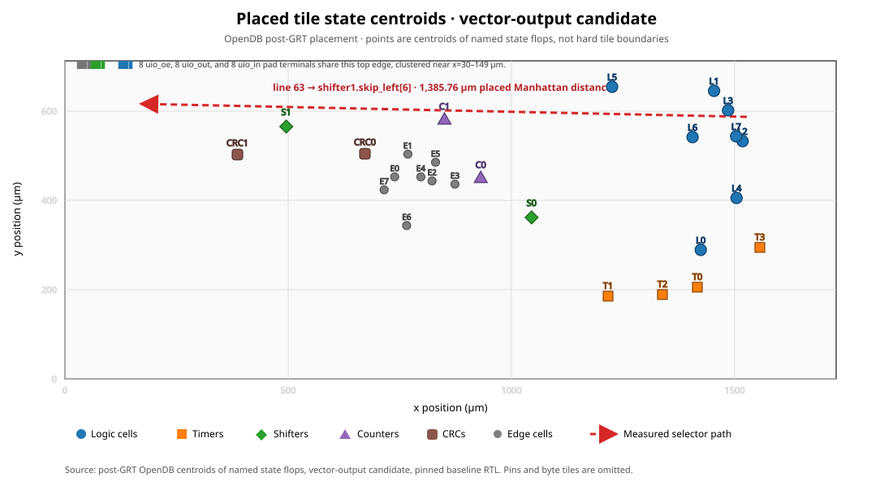

# Compiler model for alternative fabric architectures

## Decision to support

Compare plausible fabric organizations against the current 8×4 design using
the same compiled workloads and test traces. The target is useful independent
protocol work overlapping at the required latency, with less communication
distance and enough memory service capacity. Tile utilization by itself is not
an objective.

The compiler must keep three kinds of evidence separate:

1. **Exact workload facts:** configured resources and selectors, simulated
   event/cycle activity, dependency edges, and actual memory requests.
2. **Model estimates:** estimated hop count, contention, queueing, and
   resource pressure under a candidate fabric.
3. **Physical measurements:** synthesized area, placed/routed wire and delay,
   congestion, and DRC for RTL variants.

An estimate must never be reported as a measured timing or a proven speedup.

## Candidate architecture families

The first comparison should contain these candidates, all with explicit
parameters rather than hard-coded names:

| Candidate | Structure | Primary hypothesis | Costs/risks to model |
| --- | --- | --- | --- |
| `flat64` | Current shared 64-line network and shared controller/SRAM | Reference behavior and resource cost | High fanout, long selectable routes, shared service serialization |
| `channel_split` | Two channel regions, each with its current stream resources | Helps independent streams | I2C/USB stage edges cross channels; unused/unbalanced capacity |
| `stage_hierarchy` | I/O capture → bit/coding → byte/FIFO → control groups, with local links and a sparse global escape network | Keeps common producer/consumer edges local without forbidding cross-stage protocols | Escape-link contention, local port pressure, selector compatibility |
| `small_mesh` | Four or more clusters with nearest-neighbor links plus limited global links | More placement choice and shorter average routes | Router/selector complexity, hop latency, dead-end or oversubscribed paths |
| `replicated_control` | Multiple small event/control engines near their datapaths, shared configuration service | Removes controller event serialization and overlaps independent flows | Replicated state/config area, synchronization, shared SRAM bottleneck |
| `banked_memory` | 1/2/4 independently served logical banks with selectable placement | Hides independent data-access stalls | Bank conflicts, capacity/area replication, address mapping and compiler burden |

Do not assume `channel_split` is the target. Workloads already show that two
stream channels are not the same thing as two complete independent protocol
pipelines. `stage_hierarchy` is the leading interconnect hypothesis because it
preserves local stage relationships and still permits global communication.

## Workload representation

Build a workload graph from the compiled design and simulation, not from
resource-name guesses:

- A node identifies an allocated resource instance, its class, configuration,
  active cycles, and simultaneous-active intervals.
- A directed edge identifies a configured signal producer and consumer, the
  selected line, whether it is a pulse or level, observed transfer/activity
  count, and whether the consumer requires same-cycle or next-cycle behavior.
- An event node records controller or actor dispatch, wait, and service
  intervals so central serialization is visible.
- A memory node records instruction/configuration/data accesses separately,
  including request cycle, read/write, address/bank, requester, and whether the
  access can overlap another operation.
- A stream node records input/output rate, protocol deadlines, and end-to-end
  response latency from the test trace.

Static compilation can produce configuration and candidate edges. RTL
simulation must fill dynamic activity and cycle intervals. Existing optional
profiling currently records only broad controller/FIFO/shifter activity; it
does not yet give this graph. Where the simulator cannot observe a fact, the
report should mark it unknown instead of filling in a guessed value.

## Candidate mapping and costs

For every candidate architecture, enumerate legal resource placements and
routes. Apply hard constraints first: resource capacity, selector reachability,
port counts, protocol timing/correctness, memory capacity, and route
connectivity. Reject infeasible candidates with the concrete constraint that
failed.

For feasible candidates report a vector, not one opaque weighted score:

- protocol completion latency and deadline misses;
- independent work overlapped, including per-resource concurrency;
- I/O pad duty by direction, transitions, independently useful payload bits
  per cycle, lane imbalance, and distance from the workload's wire-time floor;
- communication hops, cross-cluster transfers, fanout, and estimated link
  utilization;
- memory accesses/cycle, bank conflicts, and memory-induced stall cycles;
- area estimate, configuration cost, and model confidence.

If users request a ranking, use explicit weights or Pareto dominance and print
the weights and each component. Keep hard area/timing limits distinct from
soft objectives. A lower hop count cannot compensate for a missed deadline.

Treat I/O saturation as delivered independent payload under the protocol's
timing, not the number of pads with output-enable asserted. The current VGA
trace uses 8/8 pads for 99% of its cycles but duplicates one color bit on six
pads; the stored dual-UART trace delivers 512 bytes in 20,656 cycles, within
0.86% of its two-stream serial lower bound. The first case has spare useful
lane capacity; the second is already at its external serial limit. Any
parallel-output candidate must count distinct payload bits, preserve sync and
sampling deadlines, and include memory/host supply rate. It must not claim a
throughput improvement solely from more active pads.

## Search strategy

Start with exhaustive enumeration for the small choices (actor assignment,
cluster assignment, bank placement, and routes). Record every candidate and
why it was accepted or rejected. Then add deterministic local search over
placements and link/bank assignments if the state space grows. A genetic or
other stochastic search is premature until the model has trace-backed
objectives, a legal mapper, and calibration against physical results; otherwise
it will optimize the cost model's mistakes.

Use the same traces for every alternative. Simulation of an abstract candidate
can estimate schedule and contention, but it cannot certify functional
equivalence. A candidate that changes control or datapath behavior must later
be implemented in RTL and pass the existing black-box tests before its PPA
result is treated as a real architecture result.

## Calibration loop

1. Export the current compiled configuration as resource/selector edges.
2. Collect per-cycle activity and memory transactions for representative
   concurrent-stream, control-heavy, and stored-data workloads.
3. Map those traces to each abstract topology and emit the metric vector plus
   assumptions.
4. Choose one placement/interconnect hypothesis and implement only that RTL
   variant.
5. Compare the model with synthesis, placement, global-route, detailed-route,
   and timing results. Fit or correct model parameters from measured evidence.
6. Retain or discard the hypothesis, then repeat with an unchanged baseline.

The immediate compiler deliverable should therefore be the trace-backed graph
and candidate report. It should not yet claim an automatically discovered
best architecture. The existing actor-placement report is a narrow seed: it
enumerates two actor orders and compares one-cycle actor response with a
controller service estimate, but its current locality value is only a count of
actor↔shifter references. It is not a fabric-level locality model.

## Current experiment implication

Physical experiments so far reject treating hard channel/stage clusters as an
automatic placement win: the tested hard clusters raised global-placement
congestion and area, while channel guide/fence hints did not alter placement.
The byte-line RTL duplication had inconsistent early-route results and its
detailed route remains the deciding evidence. These outcomes point toward
modeling **selective local paths plus global escape and measured fanout** rather
than simply grouping every cell in a stage into a rigid region.

The compiler's current allocations expose workload imbalance that a candidate
model must preserve. `usb.spt` uses one shifter, one timer, one CRC, both
counters, all eight logic cells, and 247 image bytes. `i2c.spt` uses both
shifters, two timers, six logic cells, both events, and 514 image bytes.
`ethernet_tx_coded.spt` uses four timers, one shifter, one CRC, three logic
cells, both events, and 363 image bytes. `uart.spt` uses both shifters and two
timers, with 60 image bytes. These examples argue against equal-sized rigid
channel islands: resource mixes and live stages vary substantially. They also
show that image capacity is not a proxy for runtime SRAM demand.

The existing RTL simulation profiles add another caution. UART loopback has
two concurrent active shifters, while each USB profile has one; I2C profiles
show two concurrent active shifters, and long controller event-wait intervals.
Those waits are not evidence of a controller throughput bottleneck by
themselves: the shifters can continue independently while the controller
waits. The graph and trace need to say whether a candidate removes a real
serialization point or merely relocates idle control.

## Compiler prototype results

The compiler now extracts named producer-consumer selectors from the actual
base configuration writes and reports channel, staged, mesh, and
capacity-constrained graph-search placements alongside the flat baseline.
Signal-line counts below are unweighted structural edges; staged and mesh hop
values are abstract distances under stated placement assumptions. The flat
network has unknown locality because RTL signal selection does not provide
physical coordinates. Coded Ethernet also has one direct shifter-to-CRC link,
shown separately because it bypasses line selectors.

| Workload | Base signal-line selector edges | Index-parity channel split: local / cross / hops | Type-based stages: local / cross / hops | Heuristic 2×2 mesh: local / cross / hops |
| --- | ---: | ---: | ---: | ---: |
| UART | 10 | 8 / 2 / 2 | 6 / 4 / 4 | 0 / 10 / 14 |
| I2C | 27 | 16 / 11 / 11 | 6 / 21 / 27 | 8 / 19 / 29 |
| USB | 36 | 20 / 16 / 16 | 11 / 25 / 35 | 11 / 25 / 35 |
| Coded Ethernet | 18 (+1 direct link) | 8 / 10 / 10 | 7 / 11 / 17 | 6 / 12 / 18 |

The deterministic `graph_search_2` local search gives UART 8/2/2, I2C
18/9/9, USB 27/9/9, and coded Ethernet 15/4/4 (local/cross/hops). Its cost
includes Ethernet's direct CRC link, while the table above is line-only. The
search starts from channel parity and moves/swaps resources subject to class
capacity limits. These assignments are hypothetical, return a local optimum,
and do not rewrite the compiled image or RTL placement.

This first pass does **not** support adopting a fixed type-based stage layout:
it increases abstract cross-cluster edges on every workload. The index-parity
two-channel heuristic has fewer cross-cluster edges in these four samples, but
the resource indices are not physical coordinates, so that result is only a
partitioning hint. The practical conclusion is to have the compiler search
resource-to-cluster assignments from the actual connection graph, with
capacity and I/O constraints, instead of baking either channel parity or
resource type into RTL placement. Context-specific selectors are retained in
the graph but the current estimate covers only the base configuration; context
banks should be evaluated as separate workload configurations.

The prototype has optional per-edge line-active-cycle sampling, but its graph
is not the full datapath graph. It records direct shifter-to-CRC links (used by
coded Ethernet) in static estimates and now measures their absorb/emit events
in a compact RTL trace. Byte-pipeline transfers, per-resource concurrent activity, memory bank
conflicts, physical coordinates, link capacity, and routing congestion are
also absent from the topology model. An additional RTL profile now measures
instruction, configuration, and data read categories, but does not model
alternative bank service or contention. The model cannot establish which
topology is fastest. Its useful result is that a compiler-visible graph can
falsify simplistic grouping assumptions before spending another full
physical-design run.

The optional RTL profiler now samples the shared 64-line bus and weights each
configured base edge by its active cycles. The same RTL variant and tool flow
were used for the following test traces:

| Trace | Simulated cycles | `channel_split` cross-edge cycles | `stage_hierarchy` cross-edge cycles / hop-cycles | `small_mesh_2x2` cross-edge cycles / hop-cycles | `graph_search_2` cross-edge cycles / hop-cycles |
| --- | ---: | ---: | ---: | ---: | ---: |
| UART loopback | 1,978 | 18 | 1,508 / 1,508 | 3,511 / 5,460 | 18 / 18 |
| I2C register read | 25,536 | 57,191 | 122,826 / 148,625 | 130,400 / 186,506 | 25,025 / 25,025 |
| USB single packet | 3,152 | 8,289 | 17,666 / 22,948 | 19,444 / 27,585 | 5,442 / 5,442 |

The dynamic table only includes configured signal-line edges; it does not
include direct shifter-to-CRC activity or byte-stage transfers. The static
graph includes both kinds of non-line links, so graph-search placement costs
account for configured data paths even though the trace-weighted search still
uses only selector activity.

This is the sum of active cycles over each configured edge; edges sharing a
line are counted separately, so the sum can exceed total simulation cycles.
It is a trace-weighted cut estimate, not transactions, wire length, or added
latency. Trace-weighted search matches the channel cut on UART and lowers it
for the I2C and USB traces. This supports compiler-selected mapping over fixed
parity for these samples. The objective remains active selector-edge cycles;
it does not model routers, queueing, added cycle latency, memory, or physical
placement. Physical calibration is required before preferring a hardware
topology.

### SRAM service trace

The optional RTL-only profiler also separates engine SRAM reads by controller
function. On `stored_bytes.spt`, the passing replay test took 11,136 cycles:
10,924 instruction-read cycles over 85 distinct addresses, 27 configuration
read cycles over 27 addresses, and 18 data-read cycles over 10 addresses. The
controller waited for the TX FIFO on 96% of sampled cycles while the shifter
was active on 97%. This trace points to host/FIFO feed rate as the observed
bottleneck for this stored-byte transfer, not SRAM service. It does not
establish that SRAM is never a bottleneck: this is one workload and the
single-port macro still serializes instruction, configuration, and data
reads. Profile stored-data and configuration-heavy traces before evaluating
bank counts, and separate host-induced FIFO waits from engine-local service
stalls.

The compiler plan now exports each configured byte stage's type and fixed
byte-tile index. The static topology graph includes directed byte links from
shifter through the configured stages, so placement costs account for data
movement as well as selectors. `byte_framing.spt` adds four links across its
TX and RX pipelines; the searched two-cluster placement keeps all four byte
links local, with two signal-selector edges still crossing clusters. The
optional RTL probe counts input-valid, output-valid, transfer, and
backpressure cycles for those stages. In the first passing `byte_framing.spt`
packet round trip (11,689 cycles), both shifters were active for 10,944 cycles,
directly confirming that two independent bit streams overlap in this workload.
The four byte links carried 18, 9, 9, and 18 transfers in that trace. The
transfer-weighted byte cut is zero for the fixed channel split and graph
search, 36 cross-cluster transfers / 72 hop-transfers for fixed stages, and 54
/ 72 for the mesh.
TX checksum and escape stages transferred 9 and 18 bytes; RX unescape and
checksum transferred 9 each. TX stage outputs were valid for 5,097 and 9,588
sampled cycles, with 5,088 and 9,570 backpressured cycles. That reflects a
slow serial consumer holding byte-stage output stable; it is not evidence of
interconnect contention or an opportunity for more physical locality by
itself. The trace accounts for byte movement and stage-level stalls, but
interval correlation across resources and latency attribution are still
needed before claiming that an architecture improves overlap.

The memory probe measures actual read-service categories under RTL
simulation, but it does not change the topology score or model parallel SRAM
banks. Next, correlate stage-level handshakes, shifter activity, FIFO level,
controller wait intervals, and input/output timestamps to separate useful
parallel work from downstream backpressure and quantify end-to-end latency.

### Direct CRC-link trace

`examples/crc_link_trace.spt` sends the full stored Ethernet wire frame through
the configured Manchester shifter with the 32-bit CRC tail, while omitting
real-time link-idle intervals. Its passing 2,464-cycle RTL test observed 480
direct-link absorb events and 32 tail emit events. The channel, stage, mesh,
and searched partitions all place this shifter and CRC in one abstract
cluster. This verifies direct-link activity for the complete frame payload,
not the controller's real-time link scheduling. The separate full real-time
coded-Ethernet integration trace is documented below.

### Combined trace-weighted placement

The compiler now has an optional combined placement estimate that consumes
the same trace's active signal-line cycles, byte-path handshakes, and direct
shifter/CRC events. Since those quantities have different units, the model
normalizes each present traffic class to one million weight units and gives
each class equal total weight. It reports the raw cross-cluster activity by
class alongside the normalized hop cost. This is a transparent search
assumption, not a claim that one byte transfer costs the same physical area or
delay as one active signal cycle.

For the byte-framing round trip (11,689 cycles), all 45 byte transfers remain
within the graph-search channel placement; only 86 active signal-edge cycles
cross clusters. Its equal-class normalized cross-hop cost is 3,386. The
fixed type-stage placement has 13,318 signal-edge cycles and 36 byte transfers
crossing, with normalized cost 1,857,785. The model therefore favors keeping
the independent TX and RX pipelines together by channel for this trace, rather
than grouping resources by type.

For the complete direct CRC frame (2,464 cycles), the shifter/CRC link records
512 events (480 absorbs and 32 tail emits). Channel split and graph search
keep every direct event local and put just one active signal-edge cycle across
clusters; their normalized cost is 282. Stage grouping also keeps the direct
link local but has 1,153 cross-cluster signal-active cycles (normalized cost
326,361). The mesh keeps the direct link local but has 3,539 such signal
cycles across clusters (normalized cost 1,674,479). The direct path therefore
reinforces co-locating the CRC with its shifter, while the signal graph
determines the rest of this placement.

These tests show that the search can weigh the observed path types together
without allowing raw unit counts to dominate. They still do not predict
router contention, physical wire length, cycle latency, area, or timing. The
new output is a candidate-selection aid for compiler/RTL experiments, not
evidence to adopt a physical cluster layout by itself.

I also swept each present traffic class to 10× weight while holding the other
class weights at 1×. The selected assignment did not change for either trace:
byte framing stays channel-partitioned when signal traffic dominates or byte
traffic dominates, and the CRC trace keeps `bits` with `fcs` when either its
signal edges or direct-link events dominate. This supports the placement for
these two graphs across a 10:1 weight range. It does not validate the equal
weight assumption for other workloads or replace an area/timing objective.

A USB data-packet trace provides a third, signal-only check: the searched
placement reduces cross-cluster active-edge cycles from 8,289 for fixed
channel split to 5,442, versus 17,666 for fixed type stages. Since this trace
has no byte or direct-link activity, only the signal class contributes. The
result extends the preference for compiler-selected grouping beyond protocols
whose resources already align with channel parity.

### Two-cluster versus four-cluster search

To test whether simply adding more structure helps, the compiler now compares
the two-cluster assignment with a four-site 2×2 mesh search. The mesh search
uses Manhattan distance, per-cluster capacities (one timer/shifter/CRC/counter/
actor, two logic cells and up to two tiles of each byte-stage class), and
searches from both a stable mesh seed and a channel-oriented seed. It minimizes
weighted hop cost with deterministic single-resource moves and same-class
swaps. Pins stay at the pad-index heuristic locations. This is still a local
abstract placement model; it has no link bandwidth, queueing, or physical
coordinates.

| RTL trace | Cycles | Two-cluster cross / hop active-edge cycles | Four-cluster cross / hop active-edge cycles | Equal-class combined cost, 2 / 4 clusters |
| --- | ---: | ---: | ---: | ---: |
| UART loopback | 1,978 | 18 / 18 | 18 / 18 | 5,126 / 5,126 |
| I²C register read | 25,536 | 25,025 / 25,025 | 42,283 / 42,295 | 144,458 / 244,158 |
| USB data packet | 3,152 | 5,442 / 5,442 | 8,512 / 8,753 | 201,813 / 324,596 |
| Byte framing round trip | 11,689 | 86 / 86 | 86 / 86 | 3,386 / 3,386 |
| Complete stored CRC frame | 2,464 | 1 / 1 | 0 / 0 | 282 / 282 |

The four-cluster search ties the two-cluster result on the UART and byte
framing traces, but its signal-edge cut is about 69% higher on I²C and 56%
higher on USB. It did not improve any tested trace. This argues against
splitting the fabric into four rigid islands as the first hardware change.
The next physical hypothesis remains two loose channel regions with selective
local paths for hot intra-channel edges and a global escape for cross-channel
protocols. Since the model omits routing capacity and congestion, that is a
candidate for RTL/physical evaluation, not a conclusion about actual routed
performance.

## Interim architecture recommendation

Preserve the programmable shared signal fabric while the compiler explores
selective local placement and datapath links. Fixed resource-type stage
clusters increase estimated cuts; fixed channel placement does not capture
every protocol dependency. The graph search keeps all four byte links local
in the framing example and leaves two selector dependencies cross-cluster, a
candidate for local paths plus a global escape network. This is a compiler
model result, not proof of physical locality or cycle reduction.

The duplicated-channel-bus RTL experiment has no completed detailed-route
comparison, so current evidence does not support adopting it. One stored-byte
trace shows FIFO backpressure dominating and few SRAM data reads, which is
insufficient reason to bank SRAM. A next hardware candidate should implement
compiler-selected local paths while preserving global escape, then compare
complete routed area, timing, congestion, and DRC against the unchanged
baseline.

### Completed real-time Ethernet trace and I/O/memory implications

The previously interrupted `real-time link pulses and a stored frame` test
was rerun to completion with direct-link event profiling. It passed in
1,920,224 simulated cycles and recorded 480 shifter-to-CRC absorbs and 32
CRC-tail emits. This closes the end-to-end functional test gap for this trace.
It does not close the I/O saturation question: direct-link events are neither
per-pin utilization nor per-channel FIFO service, and the trace deliberately
includes long cadence waits. The observed 512 events over the whole run are
not a reason to add ports, shifters, or memory banks.

RTL inspection confirms one 1024x8 single-port SRAM is shared by instruction,
configuration, and stored-data reads while the engine runs; the host owns it
only while the engine is stopped. The controller uses the same port for a
data/config read instead of fetching an instruction in that cycle. Banking
could help only if a compiler allocation and controller schedule create
concurrent instruction and data service, or if traces show sustained SRAM
service stalls. The stored-byte profile instead recorded just 18 data-read
cycles and 96% TX-FIFO wait. The macro area is 49,419 um^2, so duplicating it
has a material area cost and currently lacks a throughput case.

The top-level interface exposes eight GPIO pins, two TX/RX FIFO channel pairs
(eight entries each), and two shifters. “Use all I/O” means useful independent
streams and sustained FIFO service, not toggling every pad. The event and cycle
counters now profile UART, I2C, USB, and coded Ethernet traces. Those samples
show different useful concurrency patterns, so no single UART utilization
result should be generalized to every protocol.

| RTL trace | Cycles | Max concurrent shifters | Any-shifter active | Both active | Event-wait cycles | FIFO-wait cycles | SRAM data reads |
| --- | ---: | ---: | ---: | ---: | ---: | ---: | ---: |
| USB data packet | 3,152 | 1 | 2,247 | 0 | 2,841 | 22 | 3 |
| I2C register read | 25,536 | 2 | 24,967 | 2,261 | 24,977 | 12 | 7 |
| Coded Ethernet stored frame | 1,920,224 | 1 | 2,304 | 0 | 1,917,992 | 1,104 | 69 |

The USB, I2C, and Ethernet tests all pass byte/packet checks. They spend most
cycles waiting on protocol events; I2C is the only one of these three that
uses both shifters concurrently, and that overlap lasts 2,261 cycles. The
Ethernet run includes long cadence intervals, so its low active fraction is
expected and does not imply a fabric bottleneck. Across these traces, memory
data reads are few and do not explain the event waits. Banking SRAM would not
shorten those timer and wire intervals.

### I2C controller service and rate stress

An optional RTL-only event timeline records timer pulses, PX8 event consumes,
PX8 `FIRE` actions, actor actions, and GPIO transitions. In the controller
fallback example, the timer pulse at cycle 115 is consumed at 117, the PX8
fires its action at 119, and the UART pin starts at 122: 4 cycles from timer
event to action, then 3 more to the pin transition. The two-state actor trace
emits its action 2 cycles after its timer pulse. These are different protocol
graphs and do not form a matched A/B benchmark; they bound the control paths
that the compiler currently maps.

For I2C, one register-read transaction contains 99 SCL half-period slots: five
9-bit transfers plus the start, repeated-start, and stop patterns. The pin-level
test passes while the half-period is reduced from the normal 250 cycles down to
3 cycles. Profiling shows 547 PX8 cycles outside event/FIFO waits at every
successful rate. This decomposes into 160 instruction fetches, 159 non-wait
execute cycles, and 228 configuration-read cycles. Of those configuration
reads, 126 occur during initial setup and 102 are runtime shifter changes.

| I2C half-period | Simulated cycles | 99-slot floor | PX8 cycles outside waits | Result |
| ---: | ---: | ---: | ---: | --- |
| 250 | 25,536 | 24,750 | 547 | pass |
| 128 | 13,456 | 12,672 | 547 | pass |
| 64 | 7,120 | 6,336 | 547 | pass |
| 32 | 3,952 | 3,168 | 547 | pass |
| 16 | 2,368 | 1,584 | 547 | pass |
| 8 | 1,568 | 792 | 547 | pass |
| 4 | 1,184 | 396 | 547 | pass |
| 3 | 1,040 | 297 | 547 | pass |
| 2 | failed after 464 | 198 | incomplete | target detected START mid-byte |

The measured 547-cycle service share and the optimistic 319-cycle removable
instruction share scale as follows. The slot-floor ratio compares controller
service with the 99 half-period slots; fixed setup and response overhead are
not included in that floor.

| Half-period | Service / transaction | Optimistic instruction saving / transaction | Service / slot floor |
| ---: | ---: | ---: | ---: |
| 250 | 2.1% | 1.2% | 0.02× |
| 128 | 4.1% | 2.4% | 0.04× |
| 64 | 7.7% | 4.5% | 0.09× |
| 32 | 13.8% | 8.1% | 0.17× |
| 16 | 23.1% | 13.5% | 0.35× |
| 8 | 34.9% | 20.3% | 0.69× |
| 4 | 46.2% | 26.9% | 1.38× |
| 3 | 52.6% | 30.7% | 1.84× |

At the normal 100 kHz setting, controller service is about 2% of the complete
trace and the transaction is within 3.2% of the slot floor. At the synthetic
high-rate stress setting of 3 cycles per half-period, service accounts for
about 53% of the trace. This identifies controller work as a speed-scaling
cost, but not a normal-rate bottleneck. A second read in the same session adds
406 non-wait PX8 cycles; two reads take 50,960 cycles at HALF=250 and 1,968 at
HALF=3. The HALF=2 failure is a correctness boundary, not a clean throughput
measurement, and does not identify whether the shifter timing or controller
schedule caused it.

The profiler now separates service from protocol waits and weights each
service cycle by concurrent shifter activity. In the normal-rate one-read
trace, all 547 non-wait controller service cycles occur with zero active
shifters; the 159 retiring instruction cycles are also all in that idle
window. The remaining service is 160 instruction-fetch cycles and 228
configuration-load cycles. A scratch repeat of the same two-read transaction
at HALF=3 passes in 1,968 cycles: 953 non-wait service cycles, all with zero
active shifters, plus 968 event-wait and 47 FIFO-wait cycles. There are 311
retiring instruction cycles and 330 configuration-load cycles. This confirms
that the controller does not currently hide its work behind either shifter
for this protocol trace.

The configuration-write trace for that same repeated HALF=3 case contains
130 controller writes. Thirty-four repeat the previous value at the same
base register address; all target shifter configuration registers. Twenty-four
are configuration-block writes and ten are direct writes. If a compiler
proves these writes redundant on every path, removing the 24 block entries
could avoid 72 SRAM-read cycles and the ten direct writes could avoid up to 20
instruction cycles. That 92-cycle ceiling is 4.7% of this synthetic two-read
run and 0.18% of the two-read HALF=250 run. This is an optimization candidate,
not a compiler transformation. The profile distinguishes selected write
banks, and this test does not switch contexts; same-value writes still need
to be shown safe across branches and loop boundaries before suppressing them.
The loop optimization below targets repeated leading `.set` operations inside
one counted loop; it does not eliminate these cross-call and condition-phase
rewrites. Repeating the two-read test with that optimization leaves the count
at 34 and latency at 1,968 cycles.

An optimistic limit that removes every instruction-fetch and instruction
execution cycle but retains all configuration-load service would save at
most 319 cycles for the first HALF=250 read and 623 cycles across the two
HALF=3 reads. These are upper bounds, not projected sequencer results: a real
local controller still needs state, branch, byte-count, ACK/NACK, and handshake
work. The bound is only 1.25% of the normal-rate single-read latency, but
31.7% of the two-read HALF=3 latency. A larger local sequencer is therefore a
reasonable candidate for fast protocol modes, while the evidence does not
support adding one solely to improve the 100 kHz case. Any candidate must keep
clock stretching and host-selected arguments correct and should be compared
against the compiler schedule before RTL is changed.

This gives a useful architecture threshold: at the normal half-period of 250,
the absolute instruction-removal ceiling is only 1.2% per read. At the
synthetic half-periods of 4 and 3, controller service exceeds the ideal slot
floor, and the same ceiling reaches 26.9% and 30.7% of observed latency. The
evidence therefore favors a local sequencer only if fast I2C-class operation
is a required workload. It does not support a general-purpose local CPU or
replacing PX8 for ordinary-rate transactions. The candidate to explore is a
protocol-specific sequencer that preserves programmable host arguments and
clock-stretch behavior while removing byte/condition dispatch from the PX8.

### Measured loop-invariant tile setup hoisting

The compiler now moves constant tile `.set` operations from the leading
configuration-only portion of a host-counted loop to just after its zero-count
check. It emits the settings once, leaves settings after the first
non-configuration operation in the loop, and uses direct configuration writes
so the live loop counter is preserved. The I²C example now includes an exact
eight-byte payload test and an empty-payload test.

Against the same pinned baseline RTL, both compiler builds pass the exact
I²C peer checks at HALF=3 and HALF=250. The measured A/B results are:

| HALF | Compiler | Total cycles | Idle controller service | Instruction reads | Config reads | Config writes | Shifter cycles (0 / 1 / 2 active) |
| ---: | --- | ---: | ---: | ---: | ---: | ---: | --- |
| 3 | Before hoist | 1,968 | 941 | 1,376 | 228 | 110 | 978 / 952 / 38 |
| 3 | Hoisted | 1,760 | 731 | 1,273 | 228 | 89 | 770 / 952 / 38 |
| 250 | Before hoist | 53,184 | 941 | 52,592 | 228 | 110 | 977 / 49,946 / 2,261 |
| 250 | Hoisted | 52,976 | 731 | 52,489 | 228 | 89 | 769 / 49,946 / 2,261 |

The optimization saves 208 end-to-end cycles at both rates and removes 210
cycles of controller service. Shifter activity, configuration SRAM reads,
and wire timing are unchanged; the improvement comes from avoiding repeated
controller configuration sequences. That is a 10.6% latency reduction at the
synthetic HALF=3 rate and 0.39% at the 100 kHz HALF=250 setting. This confirms
a compiler scheduling gain, not an RTL or physical-area change. The full I²C
suite passes with the optimization, including NACK reporting, clock stretching,
multi-byte writes, and the zero-byte loop path. The remaining larger sequencer
candidate should be evaluated against this optimized compiler schedule.

This evidence supports evaluating a larger local protocol sequencer that can
advance byte/condition phases and manage local shifter handshakes without a
PX8 instruction per phase. It does not justify adding SRAM banks: this trace
uses only 7 data reads, and SRAM service is not the source of the measured
service cycles. The next compiler model should represent the byte/condition
phases, count loops, and ACK/NACK decisions explicitly, then estimate how much
controller work remains after loop-invariant settings are removed, while
preserving host parameters, repeated starts, and clock stretching. The current
4-state, single-input actor is too small for that job.

The standalone detailed route for the duplicated-channel-bus candidate is
still inconclusive: its checkpoint and log are gone, no matching GitHub Actions
run exists, and the local environment no longer has LibreLane/OpenROAD. The
main hardware checkout contains completed baseline signoff runs, which are
not candidate evidence. Keep the candidate rejected for lack of benefit, not
because a final detailed-route failure was observed.

### FIFO and GPIO utilization probe

`examples/io_saturation.spt` uses both shifters on separate GPIO output pins,
with host writes interleaved to their separate TX channels. The optional RTL
profile now counts FIFO pushes/pops, per-channel occupancy high-water marks,
shifter byte-request wait cycles, RX-full stalls, driven GPIO pin-cycles, and
per-pin output transitions. The byte-wait count distinguishes an actual
ungranted shifter request from the byte tile's speculative prefetch request.

The passing concurrent eight-byte UART case completed 16 byte transfers in
5,312 cycles. Both shifters were active together for 5,004 cycles (94.2% of
the trace), each channel transferred 8/8 bytes, and both output pins toggled
(49 transitions on pin 0 and 49 on pin 1). The serialized 8N1 wire time at
64 cycles per bit is 5,120 cycles, so observed end-to-end time is 3.75% above
that lower bound.

A single-channel 16-byte burst also passed with all 16 bytes pushed and
popped, FIFO high-water 8/8, and 10,330 cycles against a 10,240-cycle wire
time. A 32-byte-per-channel interleaved run then delivered all 64 bytes in
20,564 cycles. Both channels reached FIFO occupancy 8, all 64 pushes and
pops completed, the shifters overlapped for 20,480 cycles (99.6% of the
trace), and each had fewer than 20 cycles of denied requests due to an empty
FIFO. At 64 cycles per bit, the wire-time lower bound is 20,480 cycles; the
observed run was 0.41% above it. Each output pin toggled 161 times. This is
evidence that the current two-channel fabric sustains both configured UART
links at essentially their wire-rate limit under interleaved host service.

The initial 32-byte run appeared to fail after 20 bytes. Pin tracing showed
all transitions on the expected 64-cycle bit grid and the peer had decoded
bytes 0–19 correctly. The UART peer finished stop-bit sampling on the exact
clock boundary where the next start bit began, then missed that edge. Its
listener now checks for a new start immediately after finishing a frame; the
same 32-byte workload passes. This was a testbench boundary race, not an RTL
baud or FIFO failure.

For this workload the existing design already saturates its available serial
engines: two shifters drive two of eight GPIO pads, both channels accept
32 bytes, and measured duration is nearly the theoretical wire time. The
other pads cannot carry additional independent serial work without adding
engines or another parallel interface. Memory redistribution cannot improve
this trace: it performs one data-read cycle and zero controller FIFO/event
wait cycles. More useful architectural experiments should target workloads
where profiling shows lower overlap, high memory service demand, or internal
stage backpressure. The spatial oracle must score useful bytes plus correct
latency and stalls, not the shifter `active` bit alone.

The RTL profiler now separately counts transitions on resolved input pads
that the chip is not driving. On `uart.spt`, the loopback test completed in
1,978 cycles with 19 transitions on output pin 0 and 18 input transitions on
pin 1; the external-terminal test completed in 2,636 cycles with 15 output
and 14 input transitions. A scratch-only concurrent full-duplex test passed
in 1,356 cycles: output and input both carried two exact bytes, both shifters
were active together for 1,216 cycles, and the profile saw 15 output and 14
input transitions. The mask avoids counting the testbench's copy of an output
level onto `uio_in` as new input activity. These are transition counts, not
useful-byte bandwidth by themselves.

The four-pin `io_saturation.spt` workload allocates two output pins and two
input-capable pins, but its high-throughput case drives only the two output
directions: 32 bytes on each TX stream, 20,564 cycles total, and 20,480 cycles
with both shifters active. Its RX pins have no incoming UART traffic in that
case. We have demonstrated either two simultaneous transmit streams or one
transmit plus one receive stream with the two available shifters. We have not
demonstrated two simultaneous receive streams, or all four directions at once.
The present observed ceiling is two active serial engines, not a lack of GPIO
pads. Adding or rearranging SRAM cannot increase that engine count or the
number of external links.

### Stored-data, configuration, and protocol-wait sweep

Three 256-byte table workloads exercise SRAM-backed data at UART bit periods
of 8, 4, and 2 cycles. All passed exact byte-for-byte peer checks; the 2-cycle
case uses a single midpoint sample per bit because there is no room for the
peer's three-sample stability check. The image uses 335 of 1,024 bytes.
Results:

| Workload | Cycles | Wire-time minimum | Instruction reads | Config reads | Data reads | Controller wait | TX-empty denied request cycles |
| --- | ---: | ---: | ---: | ---: | ---: | ---: | ---: |
| Stored table, 8-cycle bit | 20,560 | 20,480 | 18,966 | 27 | 257 | FIFO 85% | 41 |
| Stored table, 4-cycle bit | 10,320 | 10,240 | 8,726 | 27 | 257 | FIFO 71% | 41 |
| Stored table, 2-cycle bit | 5,216 | 5,120 | 3,622 | 27 | 257 | FIFO 44% | 56 |

At all three rates, the shifter ran within one cycle of the 256-byte wire
time and all 258
TX pushes/pops completed (256 engine bytes plus two host test bytes). The
controller's FIFO-wait percentage counts time waiting for room in the TX FIFO;
that wait overlaps serial transmission. The direct shifter request was
denied by an empty FIFO for 41, 41, and 56 cycles respectively. Doubling the
bit rate halved transfer time without a material increase in empty-FIFO stalls.
The current single SRAM port therefore kept one UART stream fed at the
2-cycle bit setting; SRAM service did not limit this measured wire rate. The
high instruction-read count reflects the active controller stream; it is not
itself a stall measurement. A 1-cycle bit-period attempt failed the UART
stop-bit check after one byte, with the output holding its initial start level
for 11 cycles before subsequent one-cycle transitions. This is a shifter/timer
timing floor in the RTL and does not indicate an SRAM limit.

The existing `stored_bytes.spt` test used 18 data-read cycles and had 96%
controller FIFO wait, confirming that small stored transfers were dominated
by queue service. Configuration-heavy and event-driven traces show the same
separation:

| Workload | Cycles | Config reads | Data reads | Controller event wait | Controller FIFO wait |
| --- | ---: | ---: | ---: | ---: | ---: |
| Byte framing round trip | 11,689 | 99 | 1 | 0% | 0% |
| I²C register read | 25,536 | 228 | 7 | 97% | 0% |
| USB data packet | 3,152 | 180 | 3 | 90% | 0% |

These profiles place the long I²C and USB waits on protocol events; byte
framing's byte-stage output holds are caused by the slower serial consumer.
Even the USB test, which spends a notable fraction of its short run loading
configuration, spends 90% waiting for protocol events. None of these traces
show data-memory or configuration-read stalls as the throughput limiter. An
extra SRAM bank would add macro area without improving the measured serial
throughput; memory banking should be revisited only for a workload with
concurrent instruction/data demand and observed empty-FIFO or deadline impact
correlated to memory service.

### Dual stored streams and SRAM banking

An earlier compiler version could not compile a dual stored-table sender because
both shifters claimed the two TX FIFO channels and the exported-function
dispatcher needed a channel of its own. The compiler now supports the narrow
static case with `parallel { sender0.send(A); sender1.send(B) }`, reusing one
TX FIFO only after the controller consumes the call terminator. Its initial
configuration disables auto-pull on that channel, so the shifter pipeline
cannot prefetch host command bytes before dispatch. Against the pinned baseline
RTL, the paired 256-byte test is byte-exact at BIT=8, 4, and 2 and runs within
0.86%, 1.72%, and 3.75% of the concurrent wire-time floor respectively. A
sequential two-call control passes but takes about twice as long and overlaps
both shifters for only 849 cycles.

At BIT=8, the paired trace has 515 SRAM data reads, 17,984 instruction reads,
and 69 configuration reads; the 17,984 instruction count includes repeated
fetches while the controller stalls on full TX FIFOs. At BIT=2 the same streams
use 515 data reads and 2,640 instruction reads in 5,312 cycles. Both runs reach
near-wire-rate output through the existing single-port SRAM. This workload
therefore gives no throughput case for another bank. A future autonomous
per-channel stream worker might reduce controller instruction issue, but it
cannot beat the measured wire-time floor and is not justified as a throughput
change by these traces.

### I/O saturation boundary

The concurrent 32-byte UART test already sends 64 bytes in 20,564 cycles
against a two-link wire floor of 20,480 cycles. Both output shifters overlap
for 99.6% of the run, both TX FIFOs reach their eight-byte capacity, and each
channel has fewer than 20 empty-FIFO request cycles. This establishes near
wire-rate use of the two existing serial outputs for this workload. The other
GPIO pads have no independent serial shifters attached, so simply redistributing
SRAM cannot make them carry more protocol traffic. More I/O throughput requires
another parallel-capable endpoint or a wider interface; the existing two
channels are already saturated at the configured UART rate.

### Dual-channel I/O and stored-data overlap probe

The host-fed `interleaved dual-channel UART throughput` trace sends 32 bytes
on each channel at `BIT=64`. It passes in 20,554 cycles against a 20,480-cycle
wire-time floor (32 bytes × 10 bits × 64 cycles, both links concurrent). The
profile records 20,478 cycles with both shifters active, 99% total shifter
activity, 64 host TX pushes, and only 8 and 7 TX-empty stall cycles on the two
channels. For this UART workload the existing two output paths already use
nearly all available I/O bandwidth; adding output ports would not improve this
case. This does not measure unrelated GPIO inputs or other protocol rates.

| Probe | Payload | BIT | Cycles | Wire floor | Both-shifter overlap | TX-empty stalls (ch0/ch1) |
| --- | ---: | ---: | ---: | ---: | ---: | ---: |
| Host-fed concurrent | 32 bytes/channel | 64 | 20,554 | 20,480 | 20,478 | 8 / 7 |
| Stored, sequential calls | 256 bytes/channel | 8 | 40,272 | 20,480 | 849 | 19,671 / 19,724 |
| Stored, paired feeder | 256 bytes/channel | 8 | 20,656 | 20,480 | 20,473 | 47 / 108 |
| Stored, paired feeder | 256 bytes/channel | 4 | 10,416 | 10,240 | 10,233 | 47 / 108 |
| Stored, paired feeder | 256 bytes/channel | 2 | 5,312 | 5,120 | 5,114 | 47 / 123 |
| First broken paired arbiter | 256 bytes/channel | 8 | 219,840 | 20,480 | 19,751 | 23 / 199,290 |

#### Reproduction check (2026-11-20)

I reran the host-fed dual-channel UART and paired stored-table tests
sequentially against local RTL `7dd2f41`; both passed. The host-fed run took
20,564 cycles, with both shifters overlapping for 20,480 cycles and 18/19
TX-empty stall cycles. The paired stored run took 20,656 cycles, with 20,473
both-active cycles, 515 data-read service cycles, and 47/108 empty-FIFO stall
cycles. A one-channel BIT=2 stored test also passed in 5,216 cycles and
recorded 257 data-read service cycles, 56 TX-empty stall cycles, and 3,622
instruction-read service cycles. These traces reinforce that the two-link
output workload is already wire-limited and that the single-stream feeder has
controller/FIFO overhead; none demonstrates SRAM contention.

The chip has eight bidirectional `uio` pads and eight configurable pin cells,
but only two shifter/FIFO endpoints. The dual-UART test assigns four pads but
uses only the two TX outputs; unused RX assignments do not represent lost
throughput for this one-way workload. “Use every pad” is not a
workload-independent objective. A meaningful follow-up would compare a real
parallel-bus protocol that transfers multiple payload bits per cycle against
the two serial engines, reporting payload bits/cycle, pin direction/activity,
latency, and datapath/controller cost. The compiler should express that
workload and pin demand before expanding serial endpoints or adding SRAM banks.

The compiler profiler now reports chip-driven duty and peer-driven duty per
pad, plus UART peer-received payload goodput and average TX line duty. On the
two-output saturation test it records 64 peer-received bytes, 0.025 payload
bits/cycle, 99% average output-line duty, and 99% chip drive duty on each TX
pad. The full-duplex terminal test sends 2 peer-to-chip bytes; the profile
sees 1276 external input-drive pin-cycles on the RX pad over 2636 cycles (48%
duty). The output side receives 2 bytes and is active for 48% of the whole
test. This separates pin occupancy from useful payload and captures both I/O
directions. It also reports pairs of output pads whose values were identical
for every cycle both were driven. A temporary two-constant-pin program reports
`uio0=uio1`; the dual-UART stream does not report its two data pins as copies.
This is trace evidence for the workload, not a general parallel-bus
benchmark.

### Shifter endpoint replication demand

I compiled representative checked-in workloads with `spatial check` to
separate pin capacity from shifter demand:

| Workload | Shifters allocated | Pin cells allocated | What uses the shifters |
| --- | ---: | ---: | --- |
| UART full duplex | 2/2 | 2/8 | TX and RX directions |
| I²C master | 2/2 | 2/8 | SDA bit path and condition/pattern path |
| SPI master | 1/2 | 4/8 | MOSI and MISO on one full-duplex shifter |
| USB send | 1/2 | 2/8 | Coded packet stream |
| Coded 10BASE-T send | 1/2 | 2/8 | Coded frame stream plus CRC link |
| Dual UART saturation | 2/2 | 4/8 | Two independent output streams |

The competition list explicitly requires the two-transmitter UART case, and
that workload saturates both existing output shifters at its configured bit
period. The checked workload set demonstrates a need for two shifter
endpoints, but not three or four. More shifters could enable a future third
independent serial stream, but would also require more FIFO channels and host
addressing/arbitration; the eight GPIO pads alone do not provide those stream
engines. This evidence does not rule out a wider parallel datapath. It means
endpoint replication is not yet supported as a beneficial change for the
declared workload corpus. A real three-stream concurrent requirement or
parallel-bus benchmark is needed before selecting between extra serial engines
and a wider data path.

### Multi-pad workload evidence

I also profiled the existing RTL protocol generators at the top-level GPIO
pins, using their reference functional checkers:

| Workload | Cycles | Chip-driven pins | External-driven pins | Data width observed |
| --- | ---: | --- | --- | --- |
| VGA 640×480 framebuffer, 1.02 frames | 868,080 | All 8 pads, 859,715 cycles each (99.0%) | None | 1 pixel bit copied onto all 6 color pads; 2 sync outputs |
| 24-bit GPIO expander, 7 updates | 3,167 | RCLK, SER, SRCLK and LOAD, 1,670 cycles each | QH input, 1,802 cycles | One serial data bit each direction; 24 bits/update are external shift-register data |

The VGA probe passed the frame checker for every pixel and sync cycle. The six
color pads were equal on all 868,080 sampled cycles and only took the black
and white vectors; the test's 80×60 one-bit image occupies 600 bytes, and the
program plus image uses 819 bytes. A six-bit color image at the same logical
resolution would need 3,600 bytes, far above the 1 KB SRAM. The GPIO expander
probe passed the 24-edge, latch, and input-capture checks on all seven updates.
It uses four chip outputs and one chip input to move serialized data to and
from the external 74HC595/74HC165 chains.

This changes the I/O diagnosis: the VGA workload already occupies all eight
chip pads, so a generic “use more pins” change has no headroom there. Its
data-lane width is one bit despite six color pads. A multi-bit pixel output
tile could carry richer color per cycle, but it requires a streaming or much
smaller image representation to fit the present SRAM. The expander workload
already is a real serial-data use case and its 24 external bits are not a
reason to add 24 chip pins. Neither trace demonstrates that added serial
shifters or SRAM banks would improve the checked protocol set. The remaining
candidate worth modeling is a byte-wide buffered output path for workloads
that need wider payloads; it needs its own latency, input-rate, memory-capacity
and area comparison before any RTL change.

All wire floors are aggregate concurrent-output lower bounds: bytes × 10 UART
bits × BIT cycles, with the two channels transmitting together. The host-fed
case establishes that the I/O ceiling was already reachable. The stored-data
paired feeder is now byte-exact on the pinned baseline RTL: the compiler emits
an initial shifter configuration with auto-pull disabled for the dispatch
channel, preventing the shifter byte pipeline from prefetching the host call.
After consuming the call terminator, the controller enables auto-pull and the
explicit start flag together; after both shifters stop, it clears the flag and
disables auto-pull before returning to dispatch. At BIT=8, 4, and 2, the
paired feeder stays within 192 cycles of the wire-time floor. At BIT=1,
the byte-exact test failed on the first UART stop bit (low after `0x00`, at
cycle 128), so that rate is beyond the current shifter's working timing range;
it is not an SRAM or feeder throughput result.

A first version of the paired feeder passed every byte to the two TX FIFOs,
but failed to transmit channel 1 because its arbitration change yielded FIFO
ownership while the shifter was active. That run took 219,840 cycles and had
199,290 TX-empty stall cycles on channel 1. Aggregate FIFO counters hid that
the controller had written 256 bytes to each FIFO; per-channel counters
exposed the failure.

With this compiler-only arbitration schedule, two 256-byte stored streams
complete in 20,656 cycles against the 20,480-cycle wire-time floor. Both
shifters overlap for 20,473 cycles; each TX FIFO reaches its eight-byte high
water mark. The sequential stored case takes 40,272 cycles with only 849
both-active cycles. This directly shows the serialization was in feeder
scheduling and FIFO ownership for this workload, not SRAM bandwidth. At BIT=8
the profile records 515 data-read cycles and 17,984 instruction-read cycles
(51 distinct instruction addresses) through the same single-port SRAM. At
BIT=4 and 2, data reads remain 515 while instruction reads fall to 7,744 and
2,640 cycles. The instruction counts include repeated fetches while the
controller waits on full TX FIFOs; they are SRAM service events, not useful
instructions. Output latency remains within 0.86%, 1.72%, and 3.75% of the
wire-time floor at BIT=8, 4, and 2 respectively.

An earlier global RTL rule, `pulls = enable && auto_pull && (active_r || tx_request)`,
also enabled this overlap but is unsafe: the VGA single-line framebuffer test
passed on baseline shifter RTL and failed with that rule. The hardware worktree
is restored to baseline. The first compiler-only attempt disabled auto-pull
only in a runtime config write; it timed out because the shifter's explicit
start selector remained asserted while auto-pull was off. A corrected version
that also cleared the start selector still failed because the shifter's initial
config kept auto-pull enabled during boot, allowing host call bytes to be
prefetched before the runtime write. Moving the suppression into the initial
shifter config fixed both ownership windows. The current BIT=8/4/2 paired,
sequential, and host-fed simulations pass against hardware commit
`7dd2f41c3cc3065129ad6ee69599057834ad5f28`; no RTL change is needed for this
compiler behavior. This is RTL simulation evidence, not yet a gate-level or
physical timing result. The hardware GDS run for that commit is separate and
does not include the compiler changes; it has now completed successfully,
including GDS, precheck, viewer, and gate-level test jobs
([run 44337729589](https://github.com/WilliamZhang20/protocol-emulator/actions/runs/44337729589)).

Verilator lint and Yosys flatten/hierarchy checks passed against the earlier
globally modified RTL and report zero structural problems; those checks did
not catch the VGA regression. Yosys emits its existing warning that
`fabric_control_actor.v:65` memory `transition` is lowered as registers; neither
check is a physical timing result.

### What memory reorganization can actually improve

The RTL wraps a 1024×8 single-port SRAM. During engine execution, the controller
selects one address for instruction fetch, `LDM` data reads, or `CFG` reads;
`LDM` and `CFG` temporarily use the same instruction-data return path. Thus
splitting the logical address map into sectors alone would not create parallel
reads. To use multiple banks in the same cycle, the datapath needs independent
requesters/ports and an arbitration/address map that can serve them; a second
bank behind the same single controller request path mostly adds capacity, not
bandwidth.

A plausible follow-up candidate, only if higher aggregate traffic exposes a
limit, is a small autonomous stream reader near each TX FIFO, with per-stream
base/length state and a data-memory service interface. That could reduce
controller instruction issue, but adds requester logic and arbitration. A split
instruction/configuration store plus a data store is another option if a
trace shows fetches blocked behind useful data reads. The current paired test
reaches the UART wire-time floor without either change, so these remain
unproven future options rather than immediate RTL recommendations.

Physical integration also matters: the hardware uses a hard IHP 1024×8
single-port SRAM macro at floorplan coordinate (42, 81). The floorplan has a
documented keepout from x=0 to 42 across most of the macro's height because
its routing obstruction previously caused shorts. Two 512×8 banks would keep
nominal capacity but require two hard macros, more address/control routing,
and a floorplan that can fit them; duplicating the current macro would also
double nominal SRAM capacity and macro area. Yosys is available from the
hardware repo's tool bundle, but there is no local IHP standard-cell library,
OpenROAD, or LibreLane installation for a matched routed candidate run. A
completed GDS run for the exact
baseline RTL commit `7dd2f41` ([run 44337729589](https://github.com/WilliamZhang20/protocol-emulator/actions/runs/44337729589)) reports +4.295 ns slow-corner
setup slack, +0.181 ns worst hold slack across corners, zero setup/hold
violations, 1.19408 mm² total placed instance area, 0.728 mm² standard-cell
area, one SRAM macro at 49,419 µm², and 64.34% placed utilization. GDS,
precheck, viewer, and gate-level jobs passed. This is a baseline reference,
not evidence for the unmerged vector-output or SRAM-bank candidates. A rerun
for the same commit is still active, but does not change the candidate
comparison unless its results differ. The architecture model must count these
physical costs before treating bank count as a free bandwidth knob.

### Completed stored dual-channel probe (2026-11-19)

The `memory_dual_channel.spt` stored-table probe has now completed against the
pinned baseline RTL. It sends 256 bytes on each UART in 20,656 cycles against
a 20,480-cycle concurrent wire floor. Both shifters are active for 20,473
cycles, each TX FIFO reaches its eight-byte high-water mark, and the feeder
records 515 data-read service cycles, 69 configuration reads, and 17,984
instruction-read service cycles. The two output paths are therefore fed at
near wire rate despite sharing the existing single-port SRAM. This trace does
not provide evidence that another memory bank would improve throughput.

The instruction-service count is close to total runtime because the
controller continues fetching while coordinating the two senders and waiting
for FIFO room; it is not a count of useful retired work. The shifters and FIFOs
hide that controller activity well enough to maintain output overlap. Any
future feeder optimization should target controller scheduling/issue overhead
and preserve the existing paired FIFO ownership behavior. The hardware GDS
workflow for the pinned baseline has completed separately; it does not include
this compiler simulation or predict the physical impact of compiler changes.

The measured 20,656-cycle transfer is 176 cycles above the 20,480-cycle wire
floor. Therefore, for this payload and configured bit period, even an ideal
memory system that removed every memory-related delay could improve total
runtime by at most 176 cycles (0.86%). This is an end-to-end ceiling, not an
estimate that SRAM banking would recover all 176 cycles. A useful reason to
add banks would need to come from another workload with greater throughput,
latency, or concurrency headroom.

### Fresh SRAM/output activity replay (2026-11-20)

I reran the stored-byte tests against the pinned RTL with the RTL activity
profile enabled. The one-channel 256-byte run passed in 20,560 cycles: the
UART shifter was active for 20,480 cycles (99%), the controller waited on its
TX FIFO for 85% of cycles, and the SRAM serviced 18,966 instruction reads,
27 configuration reads, and 257 data reads. The output pin was chip-driven
for 99% of the trace. The two-channel 512-byte run passed in 20,656 cycles:
both shifters were active together for 20,473 cycles, each TX pin was driven
for 99%, and the controller waited on its TX FIFOs for 72% of cycles. SRAM
service was 17,984 instruction reads, 69 configuration reads, and 515 data
reads. The two-channel run is 176 cycles (0.86%) above the 20,480-cycle
two-wire floor.

These measurements strengthen the existing banking conclusion: the observed
limiter is the serial output floor plus FIFO coordination, not SRAM service.
The controller has one memory request path, so a second bank cannot serve a
second request in the same cycle today. A bank-count benefit requires a new
concurrent requester architecture (for example, independent actors with their
own local state/access path); neither current stored-byte trace demonstrates
that architecture or a bank conflict. The per-cycle profile counts current
single-port service classes but does not log competing requests from
independent requesters, so it cannot be used to claim a measured bank-conflict
rate.

### Two-condition spatial actor experiment (2026-11-19)

The current actor observes one selected signal. That is too narrow to express
some local decisions such as `tick AND ACK`, which currently need external
logic or a controller graph. A compiler/RTL experiment now lets an actor sample
two selected signal lines in the same cycle. Its transition key is
`{state, input2, input1}`; the compiler minimizes the four input combinations
and packs two five-bit transition rows into each 16-bit configuration word.
One-input graphs remain representable by tying input 2 to line 0.

The configuration address count stays eight words per actor. In a flattened,
techmapped Yosys comparison, the whole design goes from 31,004 to 31,391
generic cells (+387), including +92 sequential bits across both actors. The
isolated actor comparison is 51 FFs/277 generic cells baseline versus 97
FFs/471 cells with two inputs. This is a logic proxy, not standard-cell area,
critical-path, or routed-timing evidence. The actor's action latency remains
one cycle, and its table still supports only four states and three action
outputs.

Evidence so far: compiler mapping tests cover all four joint input values; a
source-level parser/elaborator test accepts two named inputs; the static
locality report identifies both selected lines; and the durable
`make actor-test` Verilator target drives all four combinations and passes.
The compiler-generated `protocol_control_two_input.spt` test also passes
end-to-end on the whole RTL core in 112 cycles: two configured timers supply
the input levels and the controller observes both actor action pulses. The
full hardware Cocotb suite passes (134/134), and Verilator lint plus the
flattened Yosys hierarchy check pass. These establish configuration delivery
and behavior for this small synthetic graph, not a real protocol speedup or a
physical win. The baseline hardware GDS result for `7dd2f41` is available, but
it does not include these compiler or RTL changes; no PPA result for this
modified RTL is available.

This experiment adds control expressiveness; it does not increase serial
engine count or external I/O bandwidth. The measured dual-UART and
stored-dual-UART traces already run within 0.41% and 0.86% respectively of
their concurrent wire-time floors. The two-condition actor should therefore
be judged on a control-heavy trace where it removes a measured external logic
or PX8 service dependency, not on the saturated UART benchmark. SRAM banking
remains unsupported by measured contention: the shared single-port SRAM kept
both UART streams fed at near wire rate.

### Eight-state one-input actor mode (2026-11-20)

The fixed four-state actor cannot represent a five-state pulse protocol, while
the PX8 fallback requires input events to be spaced more than ten controller
service cycles apart. I prototyped a second encoding that reuses the same eight
configuration words: bit 12 of the actor selector selects either the existing
four-state/two-input rows or eight-state/one-input rows. The compiler maps the
five-state graph to the latter and retains the former for graphs needing two
simultaneous conditions.

The matching local RTL and compiler pass a five-state UART-start scenario in
788 total core cycles. The same graph with the five transition pulses spaced
one cycle apart also passes; the actor accepts each pulse at one-cycle input
intervals and the test completes in 96 core cycles. PX8 correctly rejects
that interval under its current service model. A direct Verilator actor test
still passes all four input combinations in compact mode. The 788-cycle
end-to-end run is 16 cycles slower than the previously measured 772-cycle
controller-backed version of the same nominal five-state program, so this is
not evidence of a general latency win. The faster result demonstrates
representable event rate, not lower latency for ordinary sparse inputs.

Generic Yosys synthesis of the isolated expanded actor reports 632 generic
cells (115 sequential cells). An earlier flattened/techmapped comparison
reported 471 cells (97 sequential cells) for the two-input actor prototype,
but the synthesis recipes were not captured identically, so the apparent
34% increase is indicative only and should not be used as a precise area delta.
The widened state decode/configuration mux does add logic; a matched rerun and
physical measurement are needed before deciding whether the higher event-rate
capability is worth it. Both candidate simulations use the dirty local
two-input RTL worktree, not the compiler's pinned 1-input hardware revision.
The pinned revision cannot validate these actor mappings.

### Candidate bounds: use the VGA pads for independent color lanes

The pin trace identifies a different kind of headroom: the VGA driver enables
all eight pads for 99.0% of the frame, but pins 0, 1, 2, 4, 5, and 6 carry the
same one-bit color value. This is high electrical activity without six lanes
of independent information. The two UART output lanes are already at 99% line
duty and 0.41% above their concurrent wire-time floor, so they have no
meaningful throughput headroom for this experiment.

Both VGA versions use all eight pads, so pad occupancy does not improve. The
baseline carries one independent color bit per 16-cycle cell, or 0.0625 useful
color bits per clock; the vector prototype carries six, or 0.375 bits per
clock. That is 6× more independent color information at the same sample
cadence and pin count: 38,400 versus 230,400 useful color bits per frame.

For the existing 80×60 logical pixel image, six independent color bits per
pixel need 60 bytes per row when packed (3,600 bytes per frame). Retaining the
whole frame does not fit the 1,024-byte SRAM. The existing VGA timing repeats
each logical row for eight scanlines, so another option is to stream one
byte-per-cell row from the host on each scanline and avoid an internal
framebuffer. That is 80 bytes per 1,600-cycle line, or 38,400 bytes per 840,000-
cycle frame. At the documented host link ceiling of one byte per eight cycles,
the link can carry 105,000 bytes per frame; this stream would use about 36.6%
of that ceiling. During active cells the output consumes one byte per 16
cycles, while the host can provide one per eight cycles. The existing 8-byte
TX FIFO can absorb short bursts, with host pacing needed to prevent overflow.

The capacity math alone does not prove behavior. The isolated RTL prototype
below validates the existing 80×60 logical-cell case, including status-paced
FIFO service and blanking. A full 640×480 six-bit frame streamed without
spatial repetition would require 230,400 bytes per frame and exceed this
host-link ceiling.

The candidate needs six independently selected pixel-data bits plus
horizontal/vertical sync on all eight pads. The present shifters expose one
serial output bit each, so their existing pin selectors cannot implement this
path. An isolated RTL prototype adds per-pin selection of one shifter payload
bit, using 88 extra configuration bits and selection logic. Its short lane
test passes 80 six-bit values at exactly one
value per 16-cycle cell. The first full-frame attempt exposed that payload
bits remained visible during VGA blanking. Gating selected payload bits with
shifter-active made the isolated 640×480 stream test pass through 1.02 frames,
checking all six independent color lanes and sync pins cycle by cycle. The
host sends 80 bytes per visible scanline, including 20 extra scanlines for
wraparound; the FIFO is status-paced. The RTL prototype is isolated in
`/tmp/protocol-emulator-vector-io` and has not been merged into the hardware
worktree. Its Cocotb suite now includes both vector tests and passes 136/136;
Verilator lint is clean. The new test helpers use only top-level pins and host
commands, so the module is gate-level safe by construction. These are
functional RTL results only, with no physical area, timing, or routing
measurement.

The stricter `dead-check` also ran on the candidate: Yosys completed, but the
script reported one existing unused-input finding, `cfg_data[15:6]` in the
unchanged `fabric_control_actor.v`. The vector changes add no second finding;
this is not a clean dead-check result for the full candidate.

The current analytic model compares direct FIFO streaming with one-row and
ping-pong storage on host bytes, local reads/writes, capacity, and refill
windows. The compiler still lacks a vector-stream syntax and a legal resource
mapper for this workload. Its next step is phase-accurate FIFO scheduling
coupled to timer/pin allocation, instruction demand, and memory-port conflicts.
That can determine whether direct streaming remains feasible under a legal
concurrent mapping; physical costs still require routed measurement.

Against the completed baseline GDS, the prototype's 88 extra configuration
bits correspond to about 4,312 µm² (0.59% of standard-cell area) if each maps
to one sequential cell at the baseline's 49.0 µm² average. This estimates only
configuration storage; the per-pin payload selection muxes, additional fanout,
and route impact are unmeasured. It is a lower-cost candidate to take to
physical comparison before spending area on a row buffer.

A matched flattened generic synthesis gives a more complete logic proxy. The
reproducible flow is `read_verilog` on the hardware `RTL_SOURCES` plus the
SRAM black-box stub, `hierarchy -check -top tt_um_protocol_emulator`,
`synth -flatten -top tt_um_protocol_emulator`, then `stat -json`. With the
same Yosys 0.67+111 binary, same RTL file list, and the SRAM held as a
black box, the committed baseline `7dd2f41` has 31,338 generic cells and
40,434 wire bits; the vector candidate has 31,982 cells and 41,270 wire bits.
That is +644 generic cells (+2.06%), +836 wire bits (+2.07%), and +80
sequential cells (+1.85%). The mapping adds 140 generic muxes plus selector
logic. This supports “small logic cost” more strongly than the storage-only
estimate, but generic cells do not have physical area or wire delay. It still
needs IHP cell mapping and routed PPA before adoption.

For protocol workloads, pin duty remains a diagnostic rather than an
optimization target by itself. A pin is useful when it carries an independent
required signal at the protocol's needed rate. Duplicated waveforms, idle
directions, and saturated endpoints must be distinguished before deciding to
add lanes, engines, or memory service capacity.

### Direct stream versus local row buffer: rate and capacity comparison

The passing vector VGA trace supports an exact traffic comparison at its
80-cell logical width. Direct streaming sends 80 bytes on each of 480 visible
scanlines: 38,400 host-to-chip bytes per frame. At the test helper's measured
10 host cycles per byte, this occupies 384,000 cycles, or 45.7% of the
84,000-byte/frame helper-rate capacity. At the interface's 8-cycle/byte
minimum, it is 36.6% of the 105,000-byte/frame ceiling. The line consumes its
80 color bytes in 1,280 cycles of a 1,600-cycle period, leaving 320 cycles of
per-line host pacing margin at the helper rate. The tested 8-entry FIFO and
status-paced feeder pass without a visible underflow.

A local 80-byte row store could keep each logical color row for its eight
scanlines. The host would send 80 bytes for each of 60 logical rows, or 4,800
bytes/frame: an 8× reduction and 48,000 helper cycles/frame. The output still
needs 38,400 local byte reads/frame, one every 16 active pixel cycles. That is
4.57% of all frame cycles (6.25% of active pixel cycles). A ping-pong pair
needs 160 bytes of local storage so the host can fill one row while the output
replays the other. Storing 80 bytes per row avoids six-bit packing and bit
extraction.

The row store therefore cuts host traffic but introduces 38,400 on-chip reads,
4,800 local writes, and 88–168 total bytes of state, including the existing
FIFO. A single 80-byte store is not sufficient for continuous output at this
cadence: after displaying its row eight times, it has only 320 horizontal-
blank cycles to load the next row, versus 800 cycles at the 10-cycle host
helper rate. Its refill slack is −480 cycles. Ping-pong storage can load the
inactive row throughout the active row's 12,800-cycle repeat window, leaving
12,000 cycles of slack. If these reads use the existing single-port 1024×8
SRAM, they also compete with instruction/configuration access; separate local
banks avoid that conflict but their physical cost is unknown.

The completed baseline GDS maps 4,320 sequential standard cells to
211,632 µm², an average of 49.0 µm² per sequential cell. If an 80-byte row is
implemented as flip-flops, its 640 data bits alone are about 31,360 µm², or
4.3% of the current 727,885 µm² standard-cell area. Ping-pong's 1,280 data
bits are about 62,720 µm², or 8.6%. These are sequential-cell area proxies,
not candidate synthesis results; address, write-enable, read-selection,
routing, and timing-repair costs are excluded. Reusing the existing SRAM could
avoid those flip-flops, but runtime row writes and pixel reads would need a
new ownership/arbitration path because the current SRAM is single-port and
host programming is stopped-only.

The compiler model now accepts a competing host stream. As a stress case, add
42,000 host bytes per frame (one 8N1 byte every 20 cycles) and use 15 cycles
per byte for a status check plus TX push. Direct streaming then requires
80,400 bytes against a 56,000-byte frame capacity (143.6%, infeasible even
before channel switching); row buffering requires 46,800 bytes (83.6%). Under
that rate model, single-row storage still misses its 320-cycle refill window
by 880 cycles, while ping-pong has 11,600 cycles of refill slack. This is a
useful architecture discriminator, not yet a legal compiled multi-protocol
mapping or RTL result: channel-switch overhead, timer/pin allocation, FIFO
phase, and memory-port contention are not simulated. The current direct
stream still passes alone, so the row buffer is justified only if a concurrent
workload produces this kind of host-link pressure.

The compiler now exposes this comparison as `spatial model-stream`, with
parameters for row width/repetition, cell cadence, blanking, frame length,
host service time, FIFO depth, competing host bytes per frame, and independent
payload lanes versus occupied pads. The default VGA run reports six data lanes
and two sideband pads: 230,400 independent bits/frame, 0.375 useful bits per
active clock, and 8/8 pads occupied. With `--independent-data-lanes 1` and
`--data-pads 6`, the duplicated-color baseline keeps the same 8/8 pad use but
carries 38,400 bits/frame at 0.0625 useful bits per active clock. This makes
the sixfold information-rate difference explicit. The default VGA run reports
38,400 output bytes/frame over 840,000 cycles; direct FIFO
uses 38,400 host bytes and 8 FIFO bytes of storage at 45.7% helper-link
utilization. Single-row and ping-pong storage use 4,800 primary host bytes,
38,400 local reads and 4,800 local writes (4.6%/0.6% of frame cycles), and
88/168 bytes total storage including the FIFO (80/160 bytes for the row store
itself). Single-row refill slack is −480 cycles; ping-pong refill slack is
12,000 cycles. The concurrent 42,000-byte stress case reports direct at
143.6% of host capacity and ping-pong at 83.6%, before channel-switch
overhead. The command reports aggregate frame capacity separately from the
primary stream's per-line or refill-window slack; that window slack excludes
competing traffic and cannot establish frame feasibility. The model also
sweeps the direct stream across host-write phases against a finite TX FIFO
preloaded to capacity. At the default 10-cycle host-byte interval, all 10
phases pass with zero underflows. At 20 cycles per byte, all 20 phases fail
and the worst phase misses 4,320 cell reads. This exposes burst starvation
that aggregate frame rate can hide. In this parameterized case, a 16-byte FIFO
still misses up to 480 cells, while 32 bytes pass all 20 phases. The added
buffer depth is one possible burst-absorption remedy, but it needs RTL and
physical area/timing measurement; it is not evidence for an SRAM bank. The
sweep assumes a fixed host interval, retries blocked writes one interval
later, and makes output win same-cycle ties; it is a bounded model, not a
replacement for RTL simulation. Remaining limits are instruction traffic,
resource mapping, channel-switch costs, and physical memory timing. Tests
check the VGA arithmetic, sixfold useful-data difference at unchanged pad
count, pad over-allocation, contention, FIFO phase starvation, and invalid
row-repeat rejection.

### VGA controller/SRAM profile and direct-stream candidate

A temporary RTL-only Verilator profiler wrapped the existing
`run_framebuffer` reference checker for 1.02 frames. The checker passed all
sampled pixels and sync timing. Over 859,866 engine cycles it counted 838,292
instruction reads, 4,926 data reads, 135 configuration reads, and 4,924
controller TX pushes. The shifter was active for 628,994 cycles. This confirms
that the stored-frame implementation repeatedly reads and pushes about ten
bytes per visible scanline; it does not show an SRAM throughput stall that
causes a VGA timing failure.

For six-bit color at the existing 80-cell logical width, the prototype uses
one host-fed TX byte per cell and resends the 80-byte logical row on each of
its eight scanlines. The existing 8-byte TX FIFO buffers eight cells; the
parallel output mode exposes selected bits of the shifter's 8-bit payload to
six GPIO lanes while the timer advances one cell every 16 cycles. This avoids
a full-frame store and the SRAM read/write collision question. Each line uses
80 bytes over 1,600 cycles: 640 cycles at the host-link minimum, or 800 cycles
at the measured helper rate, leaving 800 cycles for pacing. The host resends
rows because the FIFO does not retain a row for eight scanlines.

This remains the preferred compiler/RTL candidate for multi-lane VGA over
banking. The isolated RTL prototype now passes byte-exact six-lane output at
one value per 16-cycle cell and a cycle-by-cycle 1.02-frame check of all color
and sync pins, with FIFO status pacing. This establishes functional behavior
for that implementation. The remaining gate is physical area, timing, and
routing evidence. Compiler mapping should account for six payload lanes, the
two sync pins, cell cadence, host-link service rate, FIFO depth, and row
repeats. This VGA result is separate from the serial protocol benchmarks,
whose two UART endpoints are already saturated.

I reran the complete Verilator Cocotb regression in the saved vector-output
worktree: all 136 tests pass, including both the 80-cell lane test and
full-frame VGA check. A matched generic
Yosys `synth -flatten` comparison against that worktree's `7dd2f41` baseline
reports 30,559 cells for `protocol_emulator_core` and 30,628 with vector lanes
(+69 cells); the candidate adds 80 sequential cells, primarily the two
context copies of five selector bits for each of eight pads. The isolated
shifter remains 2,306 generic cells in both versions because the new payload
output taps its existing TX register. These are generic-logic counts, not
standard-cell area or timing. This makes the vector-lane proposal a relatively
small logic-cost hypothesis with functional evidence, but physical routing and
the required link-plus-memory traffic still need measurement.

I also mapped both core variants with the same Yosys `dffunmap`, `dfflibmap`,
and ABC recipe against the IHP SG13 slow-corner standard-cell Liberty file.
The mapped core estimate changes from 460,252 to 469,633 µm² (+9,381 µm²,
2.04%); mapped resettable flops increase by 80. This is a library-based
pre-placement area proxy, not the final chip area: it omits pad/host wrapper
logic, placement buffers, routing repair, and the SRAM macro, and it provides
no routed delay. It narrows the cost estimate but does not clear the PPA gate.

### Foundry-supported memory options

Inspecting the installed IHP macro views shows that memory parallelism is
physically implementable, not just a conceptual bank-count knob. In addition
to the current 1024×8 single-port macro (146.88×336.46 µm, about 49,420 µm²),
the PDK supplies a 512×8 two-port macro. Its datasheet specifies independent
ports and one-cycle access, with no built-in conflict handling; its footprint
is 261.17×219.77 µm (57,397 µm², about 16.1% more area than the current macro
while retaining only half the capacity). The PDK also supplies 512×8 single-
port macros at 236.8×110.38 µm each. Two such banks total about 52,276 µm²,
roughly 5.8% above the existing macro, and can serve two simultaneous requests
only when the compiler/RTL maps them to different banks.

The useful experiment is an independent data-stream requester, with
instruction/configuration fetch on one port and sequential TX data reads on the
other. It directly targets the present shared-controller request path and
could remove instruction/data serialization for workloads that need refill
traffic while executing protocol logic. This is a new RTL path, not a benefit
of repartitioning addresses alone. Two 1P banks are attractive for fixed
instruction/data placement if each half fits; the 2P 512 macro offers a unified
address space but halves capacity and needs explicit same-address collision
avoidance. Both options change macro pin count and shape, which may affect the
already constrained SRAM routing channel. The current UART traces do not
justify this cost because they meet the wire-time floor, and the VGA full-frame
trace shows no SRAM-caused timing failure. Next evidence should therefore be a
compiler-generated concurrent stored-stream workload, cycle-accurate request
and stall profiling, then a matched synthesis/physical experiment only if it
shows useful overlap or latency gain.

### Matched vector-output physical experiment

The vector-output RTL prototype was run through the same local LibreLane
3.1.0.dev3 / IHP PDK commit as a clean `7dd2f41` baseline. The resolved CI and
local baseline configurations are identical after normalizing path prefixes.
Local DRT did not finish for either design: the baseline first DRT pass ended
with 29,695 violations (14,011 Metal2 shorts), and the vector candidate with
29,879 (14,439 Metal2 shorts); both then exited with a generic
`OpenROAD.DetailedRouting failed with an unexpected error` during optimization.
Those local DRT outcomes do not establish that either design is unrouteable.

The official GDS job for baseline commit `7dd2f41` succeeded and produced GDS,
OASIS, and SPEF. Its final metrics report detailed-route DRC errors 0, KLayout
DRC errors 0, LVS differences/errors 0, and slow-corner setup slack 4.295 ns.
The official artifact reports 2,300,431 µm of detailed-route wirelength and
design instance area 1,194,080 µm² including about 416,780 µm² of fill. Thus
the official result supersedes the local baseline DRT failure. GitHub run
44469585999's GL test and Tiny Tapeout precheck were still running when these
notes were recorded.

Before local DRT diverged, matched post-GRT timing/area data showed baseline
area 777,168 µm² and 53,964 instances versus vector area 792,501 µm² and 55,178
instances (+1.97% area, +2.25% instances). Both had zero setup/hold violations
at the stage timing report; setup slack was 11.328 ns baseline and 11.437 ns
vector at the typical corner. Final post-resizer global-route wirelength was
3,152,937 µm baseline versus 3,237,796 µm vector (+2.69%). The vector mode
therefore adds modest physical demand and does not improve the protocol
workloads; its multi-lane benefit is specific to VGA. Since there is no
successful official physical run of the vector candidate, these local
pre-DRT comparisons are informative but not signoff PPA. The next physical
iteration should use the known-good official GDS flow and target routing
locality/escape capacity before adding more cross-fabric selectors or memory
ports.

### Candidate ranking must include the I/O and memory service bounds

Compiled `io_saturation.spt` uses four distinct pads (two TX and two RX), both
shifters, and two timers. This is a useful dual-channel overlap workload, but
it does not establish that all eight pads can carry independent useful data in
the same protocol interval. `memory_dual_channel.spt` also uses both shifters,
with a 649-byte image, and the measured stored dual-UART trace is already
within 0.86% of the two-wire serial lower bound. A fabric or memory change
cannot improve that trace's payload rate unless it changes the external
interface or a separately measured host/data-feed stall.

Therefore the candidate evaluator should report three distinct ceilings for
each workload: (1) useful payload capacity allowed by active protocol pins and
their timing, (2) internal compute/stream service rate and overlap, and (3)
memory/host supply rate. It should report pad duty and distinct payload bits
alongside those ceilings, never substitute pad duty for throughput. Add memory
banking only when a trace shows independent requests that could be served in
parallel and a bank assignment that avoids conflicts; compare that gain with
capacity loss, macro area, and added placement/routing demand. Until those
conditions are met, redistribute compiler placements and compare sparse local
links plus global escape against channel/stage partitions, without treating
SRAM repartitioning or all-pad activity as an assumed win.

The RTL occupancy profile for `io_saturation.spt` test
`interleaved dual-channel UART throughput` confirms the distinction. The test
passed with 64 output bytes in 20,564 cycles, versus 20,480 cycles of ideal
two-UART wire time (0.41% overhead for this 64-byte trace). Both shifters were
active concurrently for 20,480 cycles, and each TX GPIO was driven for 20,499
cycles. The two declared RX pads had zero input changes; this is a dual-output
stress case, not four-way I/O traffic. FIFO empty-stall counts were 18 and 19
cycles, with 20 byte-wait cycles reported per shifter. The profile records
just one SRAM data-read cycle, so this trace has no evidence of an SRAM data
bandwidth bottleneck. This strengthens the case against memory banking for
this workload and shows that more useful pad traffic needs a parallel-output
workload or an additional independent endpoint, not merely a reshuffle of the
current SRAM.

The paired SRAM-fed UART profile makes this bound more concrete. Test
`two stored tables on concurrent UARTs` passed with 512 output bytes in
20,656 cycles, against 20,480 cycles of two-wire payload time (176 cycles,
0.86%, above the wire floor). Both shifters were active together for 20,473
cycles; each output pin was driven for 20,588 cycles. The trace records 515
SRAM data-read cycles, 17,984 instruction-read cycles, 69 configuration-read
cycles, and 155 aggregate TX FIFO empty-stall cycles (47 on channel 0, 108 on
channel 1). Both TX FIFOs reached their depth of eight bytes. These totals
confirm simultaneous stored streams and substantial SRAM service during
two-shifter activity, but do not prove how many FIFO stalls extended final
completion versus overlapped other work. Therefore an independent SRAM path
could at most recover the measured 176-cycle gap on this trace; a cycle-level
request/stall correlation is needed to know whether it would recover any of
that gap. It cannot exceed the external wire-time floor without a wider or
faster I/O protocol.

To stress shared service beyond the normal-rate case, I ran a matched two-
channel stored-table workload at a 2-cycle bit period. It passed with 512
bytes in 5,312 cycles, versus a 5,120-cycle wire floor (192 cycles, 3.75%,
above the floor). Both shifters overlapped for 5,114 cycles; each TX pin was
enabled for 5,244 cycles (98.7% of the run). The profile counted 2,640
instruction, 69 config, and 515 data read cycles: 3,224 of 5,312 cycles, or
60.7% utilization of the shared one-read-per-cycle SRAM path. The TX FIFOs
reached their depth of eight. This is strong evidence that even this fast
dual-stream trace does not saturate SRAM; adding a bank or second port has no
measured throughput case here. The read-to-push scheduling interval for the
512 paired data reads averaged 24.1 cycles (range 21–110), and 130 cycles had
at least one FIFO empty (40 had both empty, 13 overlapped activity on the peer
shifter, and 4 coincided with a data-read cycle). The 3.75% gap is therefore a
small refill/control tail to investigate, not a memory-capacity shortage.
The 3,224-cycle SRAM occupancy includes repeated instruction reads while the
controller waits: it retired 2,087 of 2,643 execute cycles, with 215 event-wait
and 341 FIFO-wait cycles, and touched only 51 unique instruction addresses.
Thus read-enable occupancy is not the same as useful memory bandwidth; some of
the busy cycles reread the blocked instruction. The independently measured
LDM-to-push pairing and near-wire-rate output are stronger evidence than the
raw 60.7% port occupancy when deciding whether banking is useful.

Single-stream feeder controls support that interpretation. The existing
256-byte SRAM-to-UART workload passed at BIT=4 in 10,320 cycles versus a
10,240-cycle floor (80 cycles over); at BIT=2 it passed in 5,216 versus 5,120
(96 cycles over). The shifter stayed active for 10,240 and 5,121 cycles,
respectively, and the output pin was enabled for 10,281 and 5,177 cycles.
Observed SRAM read-enable occupancy was 9,010/10,320 (87.3%) at BIT=4 and
3,906/5,216 (74.9%) at BIT=2. Despite the high BIT=4 read-enable ratio, the
data path remains near the serial floor; together with the dual-channel BIT=2
profile, this does not support a memory-bank change. It instead motivates
keeping read-enable occupancy separate from repeated stalled instruction
fetches and from useful data service in the compiler report.

I extended the RTL-only profile with same-cycle stall intersections and the
union across both TX channels. In the repeated stored-table run, 115 cycles
had at least one empty TX FIFO and 40 had both empty together; only 13 of the
115 had the *other* shifter active, and just 4 coincided with an SRAM data-read
cycle. Per channel, the other shifter was active for 8 channel-0 stall cycles
and 5 channel-1 stall cycles. This points away from a simple “the SRAM read
blocks the active transmitter” explanation: nearly all sampled stalls did not
overlap a data-read request. However, a request may precede the observed empty
stall by SRAM/pipe latency, so same-cycle correlation is not enough to reject
banking. The next measurement should pair each SRAM data request with its
destination FIFO push and count request-to-push latency, plus stall episodes
that overlap that interval. A dedicated requester should be considered only
if that response path is measurably delaying an output refill.

I added an ordered SRAM-data-read→engine-TX-push correlation and reran the
same test. The 515 LDM data reads pair with 512 engine pushes (256 to each
channel); three reads remain unmatched at test end. The paired interval ranges
from 21 to 145 cycles, averaging 110.1 cycles. The coarse distribution is 24
in 0–31 cycles, 3 in 32–63, 243 in 64–95, 1 in 96–127, and 241 in 128 or more.
This is the compiler's full LDM-to-FIFO-push schedule interval, not the SRAM
macro's response latency: it includes the controller instructions between
loading a byte and pushing it. It shows that stored bytes are staged ahead of
the wire consumer, but does not isolate memory-port contention. The measured
stall intersections (only four data-read/empty-stall cycles) and near-wire-rate
completion continue to provide no evidence that a second SRAM requester would
raise sustained throughput. A stronger experiment would vary instruction/data
contention while keeping pin-level work and compiler schedule constant, then
compare completion and FIFO-empty intervals on matched one- and two-port RTL.

### Current experiment ranking

The measured serial workloads reject SRAM banking as the next hardware change:
both normal-rate and 2-cycle dual-UART runs are close to their wire floors,
the fast dual-stream trace uses 60.7% of cycles with an SRAM read enable (many
instruction reads are wait-state rereads), and only four FIFO-empty cycles
coincide with a data-read cycle. The two existing TX pins already carry useful
serial traffic at near-continuous duty. The leading candidate for increasing
useful parallel I/O is the vector-output shifter path: it exposes six distinct
payload lanes plus two sync outputs in the VGA workload. It passes its
functional simulation but adds about 2% post-global-route area and 2.69%
post-resizer global-route wirelength in matched local runs. Its detailed route
is still in progress, so keep it as the candidate, not an adopted change; the
final route DRC, area, and timing decide whether the gain in independent
payload lanes is worth the physical cost.

### Fabric-link width sweep and congestion-aware placement

The static topology report routes configured dependencies over directed
abstract inter-cluster bundles and sweeps bundle widths of 1, 2, 4, 8, 16, and
32 scalar lanes. Signal and direct links count as one scalar lane; byte links
count as eight. The `graph_search_4_width` mapper uses a
deterministic local search on a 2×2 mesh and minimizes the maximum directed
bundle width first, then the total number of routed net segments. It starts
from mesh and channel-oriented seeds and respects the existing per-tile-class
placement capacities. The width evaluation unions selectors from all context
banks; that is conservative because contexts are alternative configurations,
not simultaneous traffic. Shared producer lines are counted once on common
route segments. This remains a connectivity model: it omits within-cluster
wire demand, traffic-dependent queueing, added cycle latency, physical
coordinates, and routed area/timing.

I corrected the channel-split route assumption while adding this evaluator.
The existing assignment places channel resources in regions 0/1 and shared
controller resources in region 2, so an inter-channel path crosses the
controller region and takes two links. Previous channel-split hop counts
treated every cross-region edge as one hop. The width model now represents the
three-region star explicitly. `graph_search_2` has the same shared-control
route, while the two searched data regions remain independently placeable.

I checked all 34 `.spt` examples with the compiler after adding signal, direct,
and byte-link width costs; every one compiled. Across those examples, the 2×2
width search reduces the worst directed bundle width from 5 to 4 versus the
existing hop-minimizing 2×2 mapper, and aggregate routed lane-segments from 82
to 81. A four-scalar-lane escape bundle fits all 34 modeled graphs, including
the conservative union of their context links. This does not imply the link
will sustain four simultaneous transfers: the static graph lacks trace-derived
rates and arbitration/queueing.

| Mapping hypothesis | Max directed bundle width | Routed net segments across 34 examples | Width 4 failures |
| --- | ---: | ---: | ---: |
| Channel regions plus shared-control hub | 6 | 151 | 4 |
| Fixed type stages | 10 | 316 | 9 |
| Fixed 2×2 mesh assignment | 11 | 473 | 8 |
| 2-region cut search plus shared-control hub | 6 | 97 | 3 |
| Hop-minimizing 2×2 placement search | 5 | 82 | 1 |
| Width-minimizing 2×2 placement search | 4 | 81 | 0 |

This is the best compiler-side direction so far: preserve a structured local
2×2 fabric, retain a narrow escape network, and let the compiler place
resources for each workload. It improves the modeled maximum bundle width
without increasing routed lane-segments in this corpus. It does **not** prove a
four-lane RTL network is functionally complete or physically better. The next
hardware experiment should compare that mapping and escape capacity against
the current shared bus, export its per-context route table, then run the same
protocol regressions and a completed physical route.

### Vector-output physical route retry

The isolated vector-output candidate passed RTL simulation and reached
post-global-route estimates of +1.97% area, +2.69% wirelength, and +0.109 ns
typical setup slack versus the matched baseline. Its first local detailed-route
process hit the environment's 60-minute process limit during the first
optimization pass after reporting 29,879 violations. That is neither a final
DRC result nor evidence that the design is unroutable. I preserved its run
state and resubmitted only the detailed-route stage as Slurm job 1376835 with
the same LibreLane image and PDK; it is pending a compute allocation. No new
candidate or baseline flow has been launched.

### Two-input spatial actor and trace-weighted placement

I ran `examples/protocol_control_two_input.spt` against the current local
8×4 RTL, using `SPATIAL_RTL_DIR` so the simulator did not fetch the older
pinned RTL revision. The test qualifies a four-cycle timer tick with a
six-cycle timer level, emits two actions, and passes in 112 cycles (2.2 µs).
The compiler selects the spatial actor; the existing controller fallback is
not eligible because it cannot represent a two-input graph. Its service
estimate is limited to one pulse input, so this is not yet a matched
performance comparison. The actor itself has a one-cycle pipeline in the
model. This supports local spatial protocol control for fast multi-condition
rules, though it does not yet compare matched area or routed delay against a
redesigned controller.

The same RTL trace provides a useful placement counterexample. The 2-region
search colocates both timers and the actor and reports zero cross-cluster
signal activity. The 4-region search, with its current one-timer-per-cluster
capacity assumption, places the actor and tick timer together but leaves the
ack timer across one link: 20 active signal cycles / 20 estimated hop-cycles.
The fixed channel split and stable-order mesh also report 20 cross-cluster
active signal cycles, while the stage assignment reports 40 cycles / 120
estimated hop-cycles. These are high-level-cycle counts from the RTL line
trace, not edge-event counts, measured wire traffic, or network latency. The
result argues for compiler-selectable cluster capacities and actor-aware
placement; a rigid four-region tile quota can separate a control actor from a
second input source even when a two-region placement keeps all three local.

The default compiler simulator remains pinned to the older committed RTL,
which has a one-input actor. Running this two-input feature without the local
RTL override fails after the simulator's 200,000-cycle timeout. This is a
revision mismatch: the local RTL with dual-input actor configuration passes.
Once the RTL change is committed upstream, the compiler hardware revision must
be advanced before that test can be used in the default simulator path.

### Direct CRC/shifter link under trace-weighted placement

I also profiled the complete Ethernet-frame example, which exercises a
dedicated shifter-to-CRC link. It passes in 2,464 cycles and generates 480 CRC
absorb plus 32 CRC emit events. The trace has one serial output at 96% pin
duty, 41 FIFO-empty cycles, and 69 SRAM data reads; none of those empty cycles
coincide with a data-read request. SRAM read-enable occupancy is 84%, but that
does not imply the memory is the cause of refill stalls.

The stable-order 2×2 mesh has 5,926 estimated active signal hop-cycles and
3,539 cross-cluster signal-high cycles. Stage grouping is also poor at 1,155
signal hop-cycles. The channel-local assignment, graph-search 2, hop-search
2×2, and width-search 2×2 all keep the high-rate CRC link local in the
combined signal/direct-link view; their remaining signal cost is one
low-activity restart cycle. The measured 512 direct events are local in these
assignments. This confirms that the compiler must score direct links alongside
selector signals: a selector-only trace score can mis-rank a shifter/CRC
placement even when its selector path count is low.

I added the static `graph_search_4_width` placement to the combined
trace-weighted report so its link-width objective can be compared with the
actual signal, byte, and direct-link activity on a workload. The report keeps
each traffic class visible and normalizes the nonempty classes to equal total
weight by default. That is a search heuristic, not measured physical
equivalence; final selection needs measured link rates, timing, and area.

### Per-cycle asserted-signal overlap profile

Per-edge high-cycle totals lose whether several selector dependencies are
asserted in the same cycle. The RTL profiler now also records a compressed
histogram of asserted dependency sets. For the latest USB profile, the pattern
counts sum to all 3,152 traced cycles and reconstruct every one of its 36
per-edge high-cycle totals exactly. The compiler routes each observed set over
each candidate topology and reports peak asserted-net density, net-cycles,
and the number of cycles exceeding a chosen density threshold.

| Workload | Placement | Peak asserted nets on one directed bundle | Asserted net-cycles | Cycles above 2 asserted nets |
| --- | --- | ---: | ---: | ---: |
| Dual stored UART, BIT=2 | graph search 2 | 1 | 5,169 | 0 |
| I²C register read | graph search 2 | 3 | 35,940 | 5 |
| I²C register read | hop search 2×2 | 3 | 42,295 | 1,258 |
| I²C register read | width search 2×2 | 2 | 68,007 | 0 |
| USB data packet | graph search 2 | 3 | 8,508 | 2 |
| USB data packet | hop search 2×2 | 3 | 8,246 | 4 |
| USB data packet | width search 2×2 | 3 | 8,693 | 4 |

The I²C result shows a peak-density versus total-communication tradeoff: the
width-oriented placement lowers the observed peak from three asserted nets to
two, while increasing asserted net-cycles over the hop-oriented placement.
The fast UART and protocol-actor traces have much lower asserted overlap. This
is useful activity evidence, but **not** proof that a two-lane network can
replace four lanes. A low level is still meaningful to a protocol consumer,
and the histogram does not encode destination sampling time, switching
semantics, multiplexing latency, or arbitration. The static width sweep
remains the conservative connectivity check; temporal overlap should guide
energy and scheduling studies until a cycle-accurate routed model can prove
that a narrower network preserves every level and pulse.

### Activity-aware width/locality search and I/O replay (2026-11-20)

I added `graph_search_4_width_activity` as an additional 2×2 placement
candidate. It keeps the existing hard static escape-bundle objective first,
then minimizes trace-weighted Manhattan hop-cycles, then routed net segments.
It uses mesh and channel seeds and capacity-constrained single-resource moves
and same-class swaps. It is a deterministic local search, not an exhaustive
mapper or a physical route model. Its first implementation compiled and all
25 compiler library tests passed, including a capacity and width-objective
check. On the dual-channel UART graph it chose the same locality-preserving
placement as the existing width mapper; no benefit is shown on that small
example. The compiler's static topology output and width sweep now include
this candidate.

I reran three matched simulations against pinned RTL revision
`7dd2f41c3cc3065129ad6ee69599057834ad5f28` with direct RTL profiling:

| Workload | Completion cycles | Useful output result | Profile evidence |
| --- | ---: | --- | --- |
| `io_saturation.spt`, interleaved dual-channel UART | 20,564 | 64 bytes on two independent TX pins; 20,480 simultaneous shifter-active cycles | 19 any-FIFO-empty cycles; 1 SRAM data read; each TX pad driven 20,499 cycles |
| `memory_dual_channel.spt`, parallel stored-table UART | 20,656 | 512 bytes; both TX pins transition from cycle 69 through cycles 20,535 and 20,606 | 20,487 cycles with shifters active, 115 any-FIFO-empty cycles, only 4 empty-stall/data-read overlaps; 515 data, 17,984 instruction, 69 config reads |
| `memory_dual_channel_serial.spt`, sequential stored-table calls | 40,272 | 512 bytes, but channel 0 finishes around cycle 20,535 and channel 1 around cycle 40,230 | 39,355 any-FIFO-empty cycles; 39,261 overlap a peer shifter active; 493 overlap a data read |

The first two results demonstrate useful saturation of the two configured
serial output paths: for the stored streams, the two-wire lower bound is
20,480 cycles and the measured completion is 176 cycles (0.86%) above it.
The source-level `parallel` form is decisive: the sequential variant runs
1.95× longer on the same hardware and profile shows it drains the streams in
large channel-ordered phases. The raw output-enable duty alone would obscure
this; the per-pin transition span and FIFO/shifter overlap show the actual
payload schedule. The two unused pads in the I/O stress case are inputs with
no traffic, so these tests do not show all eight pads carrying independent
useful payload.

These measurements do not justify banking or redistributing SRAM for the
tested workload. With parallel scheduling, the single SRAM-fed design already
finishes within 0.86% of the two-lane wire-time bound, and just four cycles
combine TX starvation with a data-read request. Even removing all 515 data
read service cycles cannot be credited as a speedup: almost all overlap or
instruction execution is not proven critical to final completion. The
sequential-vs-parallel delta is instead a compiler scheduling result, not a
memory-placement result. Further memory work should first expose independent
requesters and record request/queue/stall intervals; only then can banking be
evaluated against conflicts, capacity, area, and routing. For immediate
parallelism, preserve and improve compiler lowering/scheduling of the
`parallel` construct, and check that future mappings retain locality for each
active shifter/timer/pin trio.

The physical detailed-route candidate job `1376835` is still pending Slurm
priority. There is not yet completed routed area, delay, congestion, or DRC
evidence for the vector-output candidate, so this compiler and RTL simulation
evidence does not establish a physical fabric change.

### Selector-path placement evidence (vector-output GRT state)

I inspected the actual OpenDB placement and post-CTS timing path for that
candidate. One register path starts at the netlist register named
`core.counter[0].tile.lines[63]` (the RTL's line 63, driven by logic cell 7)
and ends at `core.shifter1.skip_left[6]`. In the post-GRT ODB, the driver
register is at (1526.40, 585.90) µm and the endpoint register at
(170.88, 616.14) µm: 1,385.76 µm apart by placement Manhattan distance. The
timing path traverses 28 inserted buffer cells along its selector/fanout
network. These are mapped physical coordinates and actual timing-path
instances, not compiler-model hops. Placement distance is not routed wire
length. OpenROAD reports a 432 µm global-route wire estimate for the source
net segment alone; that is not the sum of the path's buffered nets. The path
still meets setup in the current report. This is evidence of a long cross-
fabric path, not by itself evidence that segmentation will improve the full
chip's routed PPA. It strengthens the case for a locality-aware RTL experiment
and for replacing synthetic 2×2 distances with imported physical tile
coordinates in the compiler oracle.

The placement scatterplot shows why the compiler's previous regular 2×2
distance assumption needs calibration against the actual placed hardware:

The OpenDB centroid and top-level GPIO terminal coordinates used in that plot
are in [spatial-placement-vector-output.json](docs/spatial-placement-vector-output.json), with source revision, stage, and measurement definitions.

### Refill-window stall correlation (2026-11-20)

The same-cycle SRAM-read/stall intersection misses stalls that occur after a
data read but before its FIFO push. I extended the optional profiler to pair
each data-read cycle with the corresponding engine push and intersect that
interval with each TX channel's empty-stall cycles. The interval is the full
controller scheduling window, not SRAM macro latency; overlapping windows are
deduplicated per channel. Both matched profiles pass:

| BIT period | Cycles | TX-empty stalls ch0/ch1 | Empty stalls inside a matched read-to-push window ch0/ch1 | Data reads | Instruction reads |
| ---: | ---: | ---: | ---: | ---: | ---: |
| 8 | 20,656 | 47 / 108 | 23 / 38 | 515 | 17,984 |
| 2 | 5,312 | 47 / 123 | 23 / 38 | 515 | 2,640 |

So a refill interval overlaps 61 channel-stall cycles at both rates, but this
is only a possible contribution: it does not prove those stalls extend final
completion. The same 61 cycles at both rates, despite the fourfold change in
wire period, and the prior 4-cycle same-cycle intersection do not point to a
bank-count bottleneck. They narrow the follow-up: measure whether removing
controller scheduling delay inside those matched windows reduces end-to-end
completion while preserving the paired output schedule. The profiler now
reports per-channel matched-window intersections in its JSON output, and the
CLI summarizes them beside aggregate TX-empty stalls and LDM-to-push latency.

### Follow-up on memory distribution and useful pad occupancy (2026-11-20)

The active detailed-route retry is Slurm job `1376835` (`vector-drt`). At the
time of this check it remains `PENDING (Priority)` with no allocated node, so
there is no completed detailed-route result yet. Its input checkpoint,
`runs/vector-output-long/46-openroad-stamidpnr-3/state_out.json`, is present in
the bound project tree. Keep this job alive and use its final DRC, routed area,
timing, and wire metrics before deciding whether the six-lane vector-output
candidate is worth adopting.

For the vector workload, memory redistribution should first mean **small local
row storage and overlap**, not splitting the main SRAM into banks. The current
analytic `model-stream` run uses 80 cells × 480 visible lines, 16 cycles per
cell, and eight repeated scanlines per source row. Direct streaming needs
38,400 host bytes/frame. One row buffer or ping-pong rows cut that to 4,800
bytes/frame; the ping-pong candidate uses 168 bytes including the existing
8-byte FIFO, reads 38,400 output bytes locally per frame (4.6% of frame
cycles), and writes 4,800 bytes (0.6%). At this cadence a one-read-per-cycle
local store has ample service rate. This model does not include compiler
instruction traffic, arbitration, FIFO phase, or mapped physical timing, so it
establishes a rate/storage opportunity, not a verified hardware speedup. A
future hardware experiment should place the small row store near the six
output lanes and overlap row refill with output, then compare simulation and
physical results. Main-SRAM banks only become relevant if traces show multiple
independent requests in the same service window and those requests can map to
different banks.

I swept the same model over row repetition while holding an independent
42,000-byte/frame host workload and a 15-cycle host service interval fixed.
The vector needs 38,400 host bytes/frame when streamed directly, but only
`38,400 / row_repeat` bytes/frame when the host loads each logical row once.
The model gives these aggregate host-link results:

| Scanlines per logical row | Direct stream host demand | Ping-pong host demand | Ping-pong refill slack | Ping-pong storage |
| ---: | ---: | ---: | ---: | ---: |
| 1 | 143.6% of frame capacity | 143.6% (infeasible) | 400 cycles | 168 B |
| 2 | 143.6% | 109.3% (infeasible) | 2,000 cycles | 168 B |
| 4 | 143.6% | 92.1% | 5,200 cycles | 168 B |
| 8 | 143.6% | 83.6% | 11,600 cycles | 168 B |
| 16 | 143.6% | 79.3% | 24,400 cycles | 168 B |

Thus, under this stated stress case, row reuse crosses the aggregate host
capacity bound at four repeated scanlines, while direct streaming cannot fit.
This points to a small row store as a more targeted candidate than splitting
the main SRAM. It does not prove an end-to-end speedup: these figures omit
host transaction scheduling and instruction traffic, and the refill slack is
for the vector stream alone. The `model-stream` direct-FIFO phase sweep also
models only that primary stream; its phase-pass count must not be interpreted
as a contention-aware result when `--concurrent-host-bytes` is nonzero.

To model the contention directly, I added
[`experiments/shared_host_schedule.py`](experiments/shared_host_schedule.py).
It schedules host-byte transfers with earliest deadlines against exact
16-cycle vector-cell and 20-cycle UART consumption events, finite FIFOs, and
an 8-scanline ping-pong row store. With one byte every 10 host cycles, direct
streaming and the UART need 80,400 bytes/frame against capacity for 84,000;
in the initial zero-selector-cost case, the current 8-entry FIFOs cause 960
UART underflows from burst phase. Increasing both modeled FIFO depths to 16
eliminates underflow in that case. At 15 host cycles/byte, even without
selector cost, 16-entry FIFOs miss 13,906 video cells and 11,669 UART bytes,
while ping-pong refills all 4,800 row bytes/frame and completes both outputs
without underflow or a row deadline miss. At 20 cycles/byte, ping-pong misses
4,634 UART bytes and 58 row deadlines because the 46,800-byte steady-state
demand exceeds the 42,000-byte host capacity.

This cycle model assumes both input streams are always ready, prefilled
FIFOs/rows at frame start, and a one-byte-per-cycle local row store. It uses
earliest-deadline scheduling and can charge five cycles when switching the
host-selected FIFO channel. It excludes instruction traffic, exact controller
arbitration, and physical timing. It is a candidate discriminator, not proof
of a hardware speedup.

The model exposes a schedule-sensitive case at 10 host cycles/byte. With no
channel-switch cost, 16-entry FIFOs let direct streaming pass at 95.7% average
host utilization. Charging the five-cycle FIFO-select command makes the
byte-by-byte EDF schedule with 16-entry FIFOs miss 12,468 video cells and
9,351 UART bytes. A sticky-channel policy reduces those misses, but still
misses at depth 16; it passes only with much deeper FIFOs. This does not prove
that no better batching policy can make a smaller FIFO work, but it shows the
FIFO-only option depends on selection scheduling, not just average bandwidth.
At 10 cycles/byte and five-cycle switches, the tested sticky policy first
reaches zero underflows at depth 256: 5,120 FIFO data bits across two 10-bit
channels, versus 1,280 payload bits in two 80-byte row banks.
At 15 cycles/byte with the five-cycle switch cost, direct streaming misses
21,593 video cells and 14,876 UART bytes, while ping-pong rows still pass both
streams with the existing 8-entry companion FIFO and 9,601 channel switches.
At 20 cycles/byte the row-buffer schedule also fails: aggregate demand exceeds
the link capacity, producing 4,663 UART underflows and 58 row deadline misses.

I tested the FIFO-only hardware variant in a disposable copy of the
vector-output worktree, leaving the queued physical-route input untouched.
Changing both TX FIFOs from depth 8 to 16 also required widening their level
signals while preserving the host's saturated three-bit level report. The
targeted UART and vector-output Verilator suite passes all 7 tests, including
the cycle-checked 1.02-frame VGA output. Matched flattened generic synthesis
with ABC disabled changes 29,561 to 29,968 cells (+407); the design gains 160
FIFO data flops and 168 sequential cells total after pointer/count growth.
This is not a placed-area or timing result. The depth-16 variant is a smaller
storage hypothesis than two 80-byte row banks, but it does not address the
15-cycle sustained-bandwidth case in the schedule model. Row reuse remains
the stronger candidate there; it still needs an RTL implementation and
physical evaluation.

Pad utilization needs a useful-payload metric. The two UART shifters already
drive two independent TX pads at essentially their two-wire payload ceiling;
they cannot consume the other pads as UART lanes without additional shifters
or a different protocol. The vector-output candidate assigns six pads to
independent color bits and two to sync, using all eight pads for distinct
signals. This is the current strongest example of useful full-pad occupancy,
but it serves a parallel vector protocol rather than proving that general
protocol traffic can use every pad concurrently. Report payload bits per
cycle, pad roles, independent values, and timing duty together; toggling or
duplicating a signal across pads is not additional throughput.

Current decision: retain dual-UART plus vector-output as separate workload
classes. The UART result says no memory or fabric change can improve its wire
floor. The vector workload suggests compiler-managed row reuse and locality
near output lanes, but its area/timing tradeoff remains open pending job
`1376835`. After that completes, compare the same RTL candidate with the
compiler-side row-buffer candidate model and inspect whether its output
selectors create another long cross-fabric path before trying SRAM banking.

### Physical-coordinate seed for resource-index search

I applied the extracted OpenDB centroids to the compiler's existing mapping
for `examples/memory_dual_channel.spt`: `sender0` uses shifter 0 and timer 0;
`sender1` uses shifter 1 and timer 1; each shifter also drives its paired GPIO
pin. Using Manhattan distance between the source and destination state
centroids (and the `uio_out` terminal for each pin), the two shifter-to-timer
pairs are 527.466 µm and 1,100.134 µm. Of the four placed timer resources, the
minimum-sum assignment for the two shifters is timer 2 for shifter 0 and timer
1 for shifter 1: 467.057 µm + 1,100.134 µm. Counting the three configured
timer/shifter selectors per channel plus one shifter-to-pin selector per
channel gives a weighted geometric proxy of 6,741.286 µm for the current
timer-0/timer-1 assignment and 6,560.059 µm for timer-2/timer-1, a 2.69%
reduction. The maximum pair distance remains 1,100.134 µm.

I implemented this as an optional compiler report:
`spatial check <program.spt> --physical-map <placement.json>`. It reports each
located configured edge, total and maximum Manhattan distance, and an
exhaustive injective timer-index search over the slots in the map. It counts
edges with missing physical endpoints and excludes them from the score rather
than making them zero-cost. Because `Build` does not yet retain pin direction,
pin coordinates are used only for explicit `pin.drive` destinations and use
the `uio_out` terminal; edges whose source is a pin remain unlocated. The
search preserves the number of resources and keeps each index unique. It
leaves the normal compiler assignment unchanged.

The CLI built from the current Rust sources and ran on both
`memory_dual_channel.spt` and `protocol_control_two_input.spt`. For the dual
UART, it reports 8 mapped and 1 unlocated edge, with current total 6,741.286
µm and maximum edge 1,303.427 µm. The lowest-sum assignments are
`bit0=timer2, bit1=timer1` and `bit0=timer1, bit1=timer2`, each at 6,560.059 µm
(2.69% less by this proxy). The original `timer0/timer1` placement appears in
the ranked results at 6,741.286 µm. The GPIO route remains the maximum edge,
so this timer reassignment does not improve the largest geometric span. For
the two-input protocol actor, both edges terminate at an actor with no
coordinate in this placement map; the report shows 0 mapped and 2 unlocated
edges and suppresses timer ranking rather than claiming a zero-cost win.

One of the tied lowest-distance assignments now goes through the actual
compiler lowering: it recompiles with `bit0=timer2, bit1=timer1`, relocates
timer registers and signal selectors, and generates a 649-byte plan image.
Five image byte positions differ from the default timer-0/timer-1 image. I ran
that candidate plan and the default plan on the same local 8×4 RTL at revision
`7dd2f41c3cc3065129ad6ee69599057834ad5f28`. Both passed the
`two stored tables on concurrent UARTs` test in exactly 20,656 cycles. This
shows the resource remap preserves this workload's behavior; it does not
improve its cycle count. The plan confirms `bit0` moved from timer index 0 to
index 2, and `sender0.shifter.shift` moved from pulse line P4 to P8; its pin,
timer, and byte-stream behavior remained correct in simulation. The candidate
is exposed through
`spatial run --test --physical-map <placement.json> <program.spt>` for direct
functional comparison. After rounding aggregate distances to the map's
0.001 µm precision, the deterministic CLI tie-break chooses the other
equal-cost pairing (`bit0=timer1, bit1=timer2`); it has the same aggregate and
overall maximum distance. The timer-2/timer-1 plan above is still a verified
member of the tied best set.

This is a concrete compiler-side mapping candidate, not a PPA result. The map
uses placement centroids and GPIO terminals, not routed nets; the score omits
selector buffering, fanout, path timing, resource compatibility, and
congestion. The zero-cycle change is expected for this model because timer
indices alter resource selection and signal routes without changing the
protocol schedule. Keep index-order allocation as the baseline. The next
hardware experiment is a matched route of the same RTL candidate after
loading both configurations, then compare active-path delay and wire evidence.
The existing detailed-route job must finish before using routed evidence for
the separate vector-output RTL candidate.

### Timer-index search across additional traces

I extended the timer-index comparison beyond the stored dual-UART trace. For
each pair I compiled a baseline and the lowest-centroid-distance timer
assignment, then ran both plans through the same Verilator simulator and local
8×4 RTL worktree:

| Workload | Geometric proxy, baseline → candidate | RTL result |
| --- | ---: | --- |
| `io_saturation.spt` | 6,741.286 → 6,560.059 µm (−2.69%) | All seven tests pass in both; the interleaved dual-UART case is 20,564 cycles in both. |
| `memory_bandwidth_fast.spt` | 2,885.825 → 2,347.205 µm (−18.67%) | The 256-byte stored-stream test passes in both at 10,320 cycles. |
| `memory_dual_channel.spt` | 6,741.286 → 6,560.059 µm (−2.69%) | The stored dual-UART test passes in both at 20,656 cycles. |
| `ethernet_tx_coded.spt` | 13,225.887 → 12,602.473 µm (−4.71%) | Baseline and both tied candidates pass both real-time tests at 1,920,224 and 3,840,224 cycles. |

The two UART traces still have a 1,303.427 µm maximum edge in both mappings;
the fast one-shifter probe has that same pin span as its maximum. The timer
search changes the timer-to-shifter selector geometry proxy but does not
change protocol cycle counts or the external-I/O ceiling in these RTL runs. It
is therefore a compiler locality candidate, not evidence of lower latency or
improved throughput. For Ethernet, integer-precision tie-breaking selected
`half_bit=timer2, tail=timer0, cadence=timer3, pulse=timer1`. Its aggregate
proxy ties the first candidate, but the maximum edge drops from 1,770.484 to
1,651.353 µm (12.24% below baseline's 1,881.736 µm). Both Ethernet tests pass
with that exact selected assignment at 1,920,224 and 3,840,224 cycles, matching
baseline cycle counts. The physical-map objective therefore improved its
geometric proxy without changing behavior or simulated latency.
